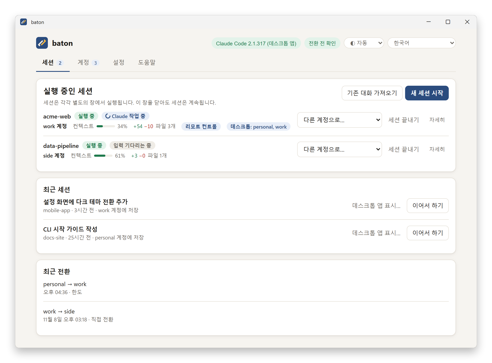
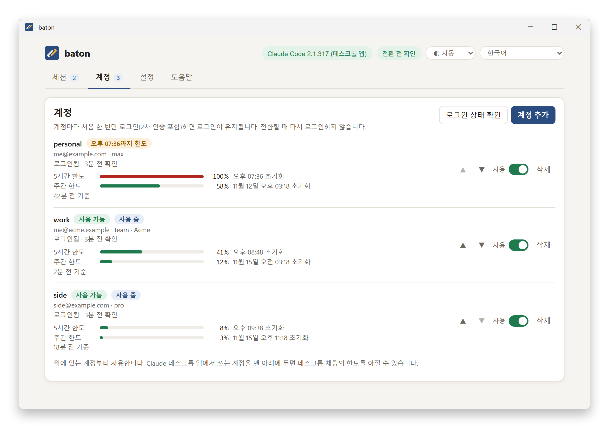
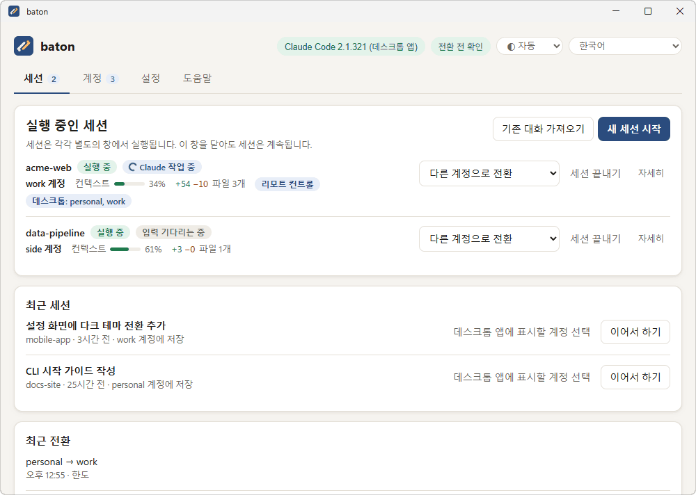
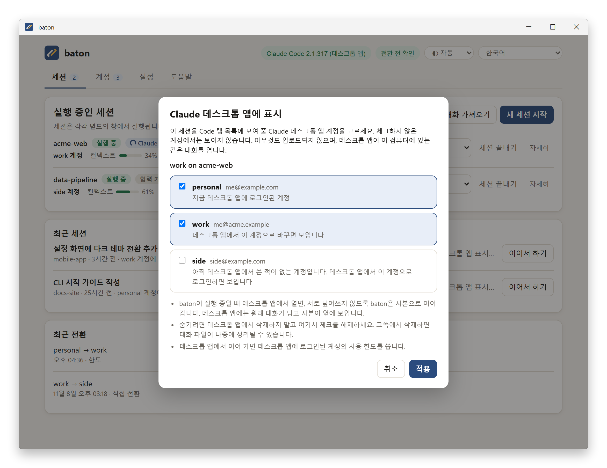
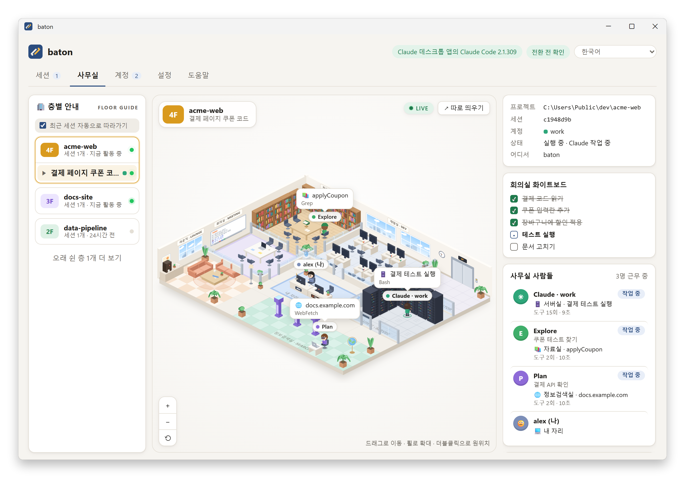
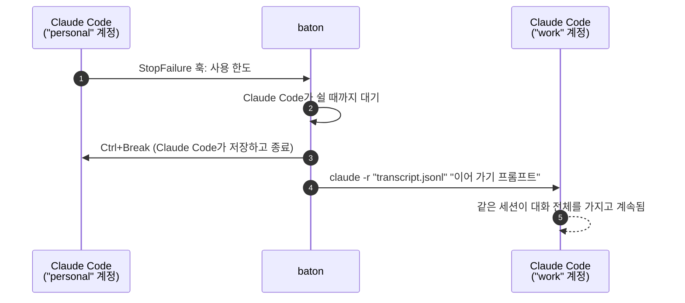

<div align="center">


# baton

**여러 개의 내 Claude 계정으로 Claude Code를 끊김 없이.**<br>
쓰던 계정이 사용 한도에 걸리면, baton이 로그인해 둔 다음 계정에서 *같은 대화*를 이어 갑니다.
내용을 복사하거나 처음부터 다시 설명할 필요가 없습니다.

[](../../releases/latest)


[](LICENSE)

[English](README.md) · **한국어**

[다운로드](../../releases/latest) ·
[시작하기](#시작하기) ·
[기존 대화 가져오기](#데스크톱-앱의-대화-가져오기) ·
[데스크톱 앱에 표시](#claude-데스크톱-앱에-세션-표시하기) ·
[사무실](#사무실) ·
[작동 방식](#작동-방식) ·
[명령줄](#명령줄) ·
[알아 둘 점](#알아-둘-점)

<br>



</div>

<br>

<picture>
  <source media="(prefers-color-scheme: dark)" srcset="docs/images/ko/sessions-dark.png">
  
</picture>

## 왜 baton인가

- 🔁 **같은 대화를 다음 계정에서.** 한도에 걸리면 baton이 Claude Code를 안전하게 멈추고, 다음 계정에서
  대화 전체를 가지고 다시 시작합니다. 한도에 걸린 그 질문도 사라지지 않습니다. 전환은 5~10초쯤 걸립니다.
- 🔐 **로그인은 계정마다 한 번.** 2단계 인증을 포함해 계정마다 처음 한 번만 로그인하면 로그인이 유지됩니다.
  로그인과 갱신은 Claude Code가 직접 하며, baton은 인증 정보를 읽거나 저장하지 않습니다.
- 🖥️ **Claude 데스크톱 앱 사용자를 위해.** 데스크톱 앱에 들어 있는 Claude Code를 그대로 쓰므로 따로
  설치할 것이 없습니다. 한국어와 영어 창을 제공합니다.
- 📥 **쓰던 대화를 그대로 가져오기.** 데스크톱 앱의 Code 탭, 터미널, VS Code에서 하던 세션을 골라
  baton에서 이어 갈 수 있습니다.
- 🗂️ **데스크톱 앱에도 표시.** 세션마다 어느 계정의 Claude 데스크톱 앱 Code 탭에 보일지 고르고, 그쪽에서도
  이어 갈 수 있습니다.
- 📊 **계정마다 한도를 한눈에.** 계정 탭에서 계정마다 5시간 한도와 주간 한도를 얼마나 썼는지, 언제
  초기화되는지 보여 줍니다. 세션 창에도 프롬프트 아래에 계정과 사용량이 나옵니다
  (`baton · work · 5시간 34% · 주간 12%`).
- 👀 **세션마다 무엇을 하는지 한눈에.** 세션 탭에서 Claude가 작업 중인지, 입력을 기다리는지, 세션 창에서
  확인이 필요한지 보여 줍니다. 모델, 컨텍스트 사용률, 폴더에서 바뀐 파일도 보여 주고, 데스크톱 앱의
  변경사항 패널처럼 목록으로도 볼 수 있습니다.
- 🔔 **자리를 비워도 알 수 있게.** 세션이 계정을 바꿨을 때, 모든 계정이 한도에 걸렸을 때, 세션 창에서 답이
  필요할 때, 오래 걸린 응답이 끝났을 때 Windows 알림으로 알려 줍니다. 알림을 누르면 세션 탭의 *창 보기*처럼
  그 세션 창이 앞으로 나옵니다. Claude가 작업하는 동안에는 PC가 저절로 절전 모드로 들어가지 않습니다.
- ♻️ **다시 시작한 뒤에도 그대로.** Windows가 다시 시작되거나 세션이 끊기면, 세션 탭에서 그 세션을 그대로 다시
  열 수 있습니다. 작업 중이던 세션은 하던 일을 계속합니다.
- 📱 **리모트 컨트롤.** 세션을 시작할 때 켜면 휴대폰의 Claude 앱이나 claude.ai/code에서 세션을 보고 이어서
  쓸 수 있습니다. 계정이 바뀌어도 알아서 다시 켜집니다.
- 🎛️ **전환 방식은 내가 정합니다.** 전환할 때마다 묻거나, 알아서 전환하거나, 직접 지시할 때만 전환하게
  할 수 있습니다. 실행 중인 세션을 언제든 다른 계정으로 옮길 수도 있습니다.
- 🧭 **폴더마다 쓸 계정 정하기.** 폴더 규칙을 두면 그 폴더(와 그 안의 폴더)의 세션은 고른 계정에서만 시작하고
  전환합니다. 회사 저장소를 회사 계정에만 둘 수 있습니다.
- 🏢 **Claude가 일하는 사무실 (재미 기능).** 설정에서 켜면 *사무실* 탭에서 이 PC의 Claude Code 대화를
  사무실 풍경으로 실시간으로 볼 수 있습니다. 파일을 읽을 때는 자료실, 코드를 고칠 때는 개발실, 명령을 실행할
  때는 서버실에 가고, 물어볼 게 생기면 내 자리로 옵니다. 서브에이전트는 엘리베이터로 출근하고, 프로젝트마다
  층이 하나씩 있습니다. 따로 띄워 다른 모니터에 둘 수도 있습니다.
- ⌨️ **명령줄도 함께.** `baton.exe`로 터미널과 스크립트에서 같은 기능을 쓸 수 있습니다.
- ⬆️ **업데이트는 클릭 한 번.** 새 버전이 나오면 알려 주고, GitHub에서 받아 체크섬을 확인한 뒤 설치합니다.

> [!IMPORTANT]
> **본인 소유의 계정만** 쓰세요. Anthropic 약관과 이용 정책은 여러 계정으로 제한을 피하는 것도
> 금지합니다. 한도에 걸린 뒤 다른 계정으로 이어 쓰는 것이 바로 그런 행위로 판단될 수 있고, 계정이 예고
> 없이 정지될 수 있습니다. 전환을 켜기 전에 [알아 둘 점](#알아-둘-점)을 읽으세요.

## 시작하기

Windows 10/11의 Claude 데스크톱 앱 사용자 기준입니다.

1. [Releases](../../releases/latest)에서 `baton_<버전>_windows_amd64.zip`을 **받아 압축을 풉니다**
   (zip에서 마우스 오른쪽 → *모두 압축 풀기*). ARM 노트북(Snapdragon 등)은 `…_arm64.zip`을 받습니다.
2. **`baton-app.exe`를 엽니다.** 서명되지 않은 프로그램이라 처음에 "Windows의 PC 보호" 창이 뜰 수
   있습니다. *추가 정보 → 실행*을 누르세요.
3. **안내를 읽고** 계정 전환 방식을 고릅니다. *전환 전 확인*을 권장합니다.
4. **계정을 추가합니다.** 계정마다 브라우저에서 한 번 로그인합니다. 두 번째 계정부터는 브라우저가 첫
   계정으로 로그인되어 있을 수 있으니 *브라우저가 이미 다른 Claude 계정으로 로그인되어 있어요*를 켜 두세요
   (계정이 하나라도 로그인되어 있으면 켜져 있습니다). 로그인 화면이 InPrivate 창에서 열리고, 평소
   브라우저의 로그인은 그대로입니다.
5. **세션을 시작합니다.** 작업할 폴더를 고르면 Claude Code가 별도의 창에서 열리고, 작업은 그 창에서
   평소처럼 합니다. baton 창을 닫아도 세션은 계속됩니다.
6. *선택:* **도움말 → 시작 메뉴에 설치**를 누르면 시작 메뉴에서 열 수 있고, 업데이트한 뒤에도 작업
   표시줄 고정이 유지됩니다.

Claude 데스크톱 앱 자체의 로그인은 바뀌지 않습니다. baton의 계정들은 데스크톱 앱과 따로 로그인됩니다.

<picture>
  <source media="(prefers-color-scheme: dark)" srcset="docs/images/ko/accounts-dark.png">
  
</picture>

## 데스크톱 앱의 대화 가져오기

**기존 대화 가져오기**를 누르면 모든 폴더의 Claude Code 대화가 최신순으로 나옵니다. Claude 데스크톱
앱의 세션(앱에서 붙은 이름 그대로), 터미널과 VS Code에서 한 대화, baton 계정에 저장된 대화가 모두
포함됩니다. 대화를 고른 뒤 시작할 계정을 정하면, 그 대화를 하던 폴더에서 이어집니다.

<p align="center"></p>

- **어디에서도 열려 있지 않은 대화:** 그 대화 자체를 baton에서 이어 갑니다.
- **데스크톱 앱이나 터미널에서 아직 열려 있는 대화:** baton이 알아서 **사본**으로 이어 가고, 원래 대화가
  어디에서 열려 있는지 알려 줍니다. 두 곳에서 한 대화에 쓰면 대화가 갈라지므로 baton은 그렇게 하지 않습니다.
  사본은 지금까지의 내용을 모두 이어받은 새 대화이고, 원래 대화는 그대로 남으며, 그 뒤로 둘은 따로
  진행됩니다. 같은 대화로 이어 가려면 먼저 다른 쪽을 종료한 뒤(데스크톱 앱은 트레이 아이콘에서까지 완전히
  종료해야 합니다. 창을 닫는 것만으로는 대화가 닫히지 않습니다. 터미널이면 그 Claude Code를 끝내세요)
  *다시 확인*을 누르세요.
- **이미 baton에서 실행 중인 대화:** 다시 시작해도 세션을 하나 더 열지 않고, 그 세션 창을 앞으로 가져옵니다.
- **폴더가 없어진 대화:** 대화는 원래 폴더에서만 이어 갈 수 있으므로, 폴더가 없다고 표시합니다.

사본이 아니게 가져온 대화는 양쪽이 같은 대화입니다. baton과 데스크톱 앱이 같은 파일을 읽고 쓰므로, 다음에
여는 쪽이 다른 쪽에서 나눈 대화까지 모두 이어 갑니다. 두 곳에서 동시에 열려 있으면 Claude Code는 알아채지
못하지만 baton은 알아챕니다. baton이 실행 중인 대화를 데스크톱 앱, 터미널, 다른 baton 세션에서 열면, baton은
같은 계정에서 세션을 사본으로 옮깁니다. Claude가 쉬고 있으면 바로, 응답 중이면 그 응답을 마치는 대로(또는
기다리던 질문에 답한 뒤) 옮깁니다. 알림과 세션 줄에서 알려 주고, 다른 쪽은 원래 대화에서 이어 갑니다.
사본에서도 세션의 권한 모드는 그대로입니다. 다른 계정으로 전환할 때와 끊긴 세션을 다시 열 때도 같아서,
그때 대화가 다른 곳에서 열려 있으면 사본으로 이어 갑니다.

baton이 막을 수 없는 경우: 다른 쪽에서 대화를 열 때 baton에서 이미 진행 중이던 응답(또는 답을 기다리는
질문)은 중간에 끊지 않으므로 원래 대화에 기록됩니다. 그 응답이 끝나기 전에 다른 쪽에서 입력하거나, baton이
알아채기 전(몇 초마다 확인합니다)에 양쪽에서 입력하면 그 대화가 갈라집니다. 그래도 지워지는 것은 없고,
baton 쪽에서 한 말은 모두 사본에 남습니다.

명령줄에서는 다음과 같이 합니다.

```bash
baton sessions
```

```bash
baton resume 2cd067ab-193c-4e56-baa2-0b34dc203160
```

다른 곳에서 열려 있으면 알아서 사본으로 이어 갑니다. 그래도 원래 대화를 그대로 두려면 `--copy`를 붙이세요.

## Claude 데스크톱 앱에 세션 표시하기

실행 중인 세션(*자세히* 안)이나 *최근 세션*에서 **데스크톱 앱에 표시할 계정 선택**을 누르고, Code 탭 목록에 이 세션을
보여 줄 Claude 데스크톱 앱 계정을 체크한 뒤 **적용**을 누르세요. 체크하지 않은 계정에서는 보이지 않습니다.
데스크톱 앱에 지금 로그인된 계정은 baton 계정이 아니어도 목록에 나옵니다. 아무것도 업로드되지 않습니다.
데스크톱 앱이 이 PC에 있는 같은 대화를 열기 때문에, 어느 쪽에서 나눈 대화든 다른 쪽에도 보입니다. 첫
메시지를 보낸 뒤부터 표시할 수 있습니다.

<picture>
  <source media="(prefers-color-scheme: dark)" srcset="docs/images/ko/desktop-dark.png">
  
</picture>

- **언제 보이나요.** 데스크톱 앱에 로그인된 계정에서는 앱을 다음에 시작할 때 보입니다. 앱이 지금 열려
  있다면 완전히 종료(트레이 아이콘에서도)했다가 다시 여세요. 다른 계정에서는 앱에서 그 계정으로 바꾸면
  보입니다. 목록에서 뺄 때도 같습니다. 앱에 로그인된 계정에서 뺄 때는 앱을 종료할 때까지 baton 창을 열어
  두세요. 앱이 닫힐 때 baton이 그 항목을 지웁니다.
- **선택은 세션을 따라갑니다.** `/clear` 뒤나, baton이 스스로 사본으로 이어 간 뒤에도 데스크톱 앱에는
  세션이 지금 이어 가는 대화가 보입니다. 직접 요청한 사본(창에서 고르거나 `baton resume --copy`)은 아무
  계정도 체크되지 않은 채 시작합니다.
- **baton이 실행 중일 때 데스크톱 앱에서 열면** 서로 덮어쓰지 않도록 baton은 사본으로 이어 갑니다.
  데스크톱 앱에는 원래 대화가 남고, baton의 사본은 그 옆에 "*이름* (baton)"으로 보입니다.
- **데스크톱 앱에서 이어 간 뒤에는** 그 계정의 항목이 데스크톱 앱의 것이 됩니다. baton에는 체크된 채
  잠겨 보이고, 숨기려면 앱에서 보관하세요.
- **숨기려면 baton에서 체크를 해제하세요.** 데스크톱 앱에서 삭제하면 대화 파일이 나중에 정리될 수
  있습니다. 그쪽에서 삭제했다면 다시 체크할 때까지 baton도 그대로 둡니다.
- **데스크톱 앱에서 만든 대화**는 그 대화를 만든 계정의 목록에 그대로 남습니다. 숨기려면 앱에서
  보관하세요. baton은 앱이 직접 만든 항목을 바꾸거나 지우지 않습니다.
- **고를 수 없는 계정도 있습니다.** API 키, 클라우드 제공자, 게이트웨이, 장기 토큰으로 로그인하는
  계정입니다. 데스크톱 앱에 그 계정의 목록이 없거나, 토큰만으로는 어떤 Claude 계정인지 baton이 알 수
  없습니다. 이 버전이 된 뒤 아직 확인하지 않은 계정은 계정 탭에서 *로그인 상태 확인*을 누르면(또는
  `baton doctor`) 고를 수 있습니다.
- **데스크톱 앱에서 이어 가면** 앱에 로그인된 계정의 사용 한도를 씁니다.
- **세션 줄에 어디에 보이는지 나옵니다**("데스크톱: personal, work"). 데스크톱 앱에 표시한 세션은
  나중에 뺄 수 있도록 *최근 세션*에 계속 남습니다.

명령줄에서는 다음과 같이 합니다(계정 이름은 쉼표로 구분, 옵션 없이 실행하면 보여 주기만 합니다).

```bash
baton desktop 2cd067ab-193c-4e56-baa2-0b34dc203160 --show personal,work
```

## 사무실

**설정 → 사무실 보기 (재미 기능)**을 켜거나 `baton config office true`를 실행하면 창에 **사무실** 탭이
생깁니다. 왼쪽 층별 안내에는 프로젝트마다 건물의 층이 하나씩 있고, 오른쪽에는 세션 정보, 회의실 화이트보드의
할 일 목록, 사무실에 누가 있고 무엇을 하는지가 나옵니다. 아래 그림에서 Claude는 서버실에서 테스트를 돌리고,
Explore 서브에이전트는 자료실에서 코드를 찾고, Plan 서브에이전트는 정보검색실에서 문서를 읽고 있습니다.
*따로 띄우기*를 누르면 사무실만 별도 창으로 뜹니다.

<picture>
  <source media="(prefers-color-scheme: dark)" srcset="docs/images/ko/office-dark.png">
  
</picture>

- **층.** 프로젝트 폴더 하나가 층 하나이고, 그 폴더에서 연 대화는 어느 계정이든, 데스크톱 앱이든 터미널이든
  모두 그 층에 있습니다. 층 번호는 유지됩니다. 어떤 프로젝트의 대화가 baton이 아는 모든 Claude Code 폴더에서
  지워지면 그 번호는 다음 새 프로젝트가 이어받습니다. 대화가 오래되었을 뿐인 프로젝트는 층을 지키고, 건물에
  있는 층의 번호는 바뀌지 않습니다.
- **옆 열.** 층별 안내나 패널 옆의 구분선을 끌면 그 열의 너비가 바뀌고, 두 번 클릭하면 원래 너비로
  돌아갑니다. 키보드로도 됩니다(←/→, Shift를 누르면 크게, Home/End, Enter로 접기/펼치기). 정한 너비는 탭과
  따로 띄운 창 각각에 대해 baton이 기억합니다. 두 열이 다 들어가지 않으면 마지막에 조절한 열은 너비를
  지킵니다. 창이 더 좁으면 패널이(더 좁으면 층별 안내도) 옆에서 빠지고, 사무실 위쪽의 버튼을 누르면 사무실
  위에 펼쳐집니다(Esc로 닫기). 페이지는 스크롤되지 않습니다.
- **사무실에 보일 것.** 층별 안내에서 세션이나 층 전체의 체크를 풀면 사무실에서만 숨겨집니다. 세션 자체는
  그대로이고, *최근 세션 자동으로 따라가기*는 숨긴 세션을 건너뜁니다. 층 전체를 숨기지 않았다면 새 세션은
  보입니다. *숨긴 항목 N개 보기*로 숨긴 것을 보고, *모두 다시 보이기*로 한 번에 되돌립니다.

## 작동 방식



- **계정마다 프로필 하나.** 계정마다 별도의 Claude Code 프로필(`CLAUDE_CONFIG_DIR`)을 씁니다.
  로그인과 갱신은 Claude Code가 직접 하므로, baton은 인증 정보를 읽거나 저장하거나 보내지 않습니다.
- **진짜 Claude Code.** `baton run`은 콘솔에서 대화형 `claude.exe`를 실행하고, 훅을 더한 설정 파일을
  넘깁니다. 응답이 사용 한도로 끝나면 `StopFailure` 훅이 baton에 알립니다.
- **깔끔한 전환.** baton은 Claude Code가 쉴 때까지 기다렸다가 Ctrl+Break로 멈춥니다. 그러면 Claude가
  대화 기록을 저장하고 정상 종료합니다. 이어서 baton이 다음 계정에서
  `claude -r "<transcript>" "<이어 가기 프롬프트>"`로 다시 시작합니다. 세션 id와 대화 파일은 그대로이고,
  새 계정은 한도에 걸린 질문까지 포함한 대화 전체를 받습니다.
- **창.** `baton-app.exe`는 작은 로컬 페이지를 자체 WebView2 창에 보여 줍니다. WebView2는 Windows
  11과 거의 모든 Windows 10에 들어 있고, 없으면 기본 브라우저에서 열립니다. 창은 로그인, 세션, 계정
  변경을 모두 `baton.exe`로 실행하므로 창과 명령줄이 같은 규칙을 따릅니다. 페이지는 127.0.0.1에서 그
  창에만 제공됩니다. 창 주소의 일회용 코드를 토큰으로 바꾸고, 모든 요청이 그 토큰을 헤더에 담아
  보냅니다(쿠키는 쓰지 않음). 페이지와 같은 출처에서 온 요청만 받습니다.

## 설치

릴리스 zip에는 `baton-app.exe`(창), `baton.exe`(명령줄, 둘을 같은 폴더에 두세요), README와 라이선스가
들어 있습니다. 받은 파일은 `checksums.txt`와 비교해 확인할 수 있습니다.

```bash
Get-FileHash baton_0.8.2_windows_amd64.zip -Algorithm SHA256
```

창의 **도움말 → 시작 메뉴에 설치**는 baton을 `%LOCALAPPDATA%\Programs\baton`에 복사합니다. 명령줄을
어디서나 쓰려면 그 폴더(또는 압축을 푼 폴더)를 `PATH`에 추가하세요.

**업데이트.** **도움말 → baton 업데이트**는 GitHub에서 최신 릴리스를 확인하고 바뀐 점을 보여 줍니다. 창이
열려 있는 동안에도 몇 시간마다 확인해서, 새 버전이 나오면 배너로 알려 줍니다. *…(으)로 업데이트*를 누르면
릴리스를 내려받아 그 릴리스의 `checksums.txt`와 비교한 뒤 시작 메뉴에 설치하고 새 창을 엽니다. 실행 중인
세션은 먼저 끝내고, baton이 연 창도 닫으세요. 명령줄에서는 다음을 실행합니다.

```bash
baton update
```

**Claude Code.** baton은 이 PC의 Claude Code 중 baton과 쓸 수 있는(2.1.268 이상) 가장 새 버전을 씁니다.
어디에 설치했든(기본 설치 프로그램, WinGet, Scoop, npm, `PATH`) Claude Code CLI이거나, Claude 데스크톱 앱에
들어 있는 것입니다. 데스크톱 앱 쪽은 앱의 Code 탭을 한 번 열면 생깁니다. *설정 → 고급 설정 → 사용할 Claude
Code*에는 찾은 것이 모두 버전과 함께 나오고, 쓸 수 없는 것은 그 이유도 나옵니다. 여기서 자동, 데스크톱 앱의
것(앱 업데이트를 따라감), 특정 하나, 또는 `claude.exe` 경로를 고를 수 있습니다. 고른 것을 잠시 쓸 수 없으면
baton은 다른 것을 쓰면서 그렇다고 알려 주고, 다시 쓸 수 있게 되면 고른 것으로 돌아갑니다. 데스크톱 앱이
업데이트하면서 지운 버전을 골라 두었다면 앱의 새 버전을 따라갑니다. CLI 버전이 낮다고 나오면 *CLI 업데이트*가
그 CLI의 `claude update`를 실행합니다(WinGet, Scoop, npm으로 설치한 것은 그 패키지 관리자로 업데이트하며,
baton이 명령을 알려 줍니다). Claude 데스크톱 앱이 있다면 앱의 Code 탭을 한 번 여는 것으로도 됩니다. 그러면
baton이 앱에 들어 있는 Claude Code를 씁니다. `baton config allow_desktop_bundle false`로 하면 자동 선택에서
데스크톱 앱의 것을 뺍니다. CLI를 설치하려면 다음을 실행합니다.

```bash
powershell -c "irm https://claude.ai/install.ps1 | iex"
```

<details>
<summary><b>소스에서 빌드</b> (Go 1.27+)</summary>

```bash
go build -trimpath -o bin/baton.exe ./cmd/baton
```

```bash
go build -trimpath -ldflags "-H windowsgui -X main.guiBuild=1" -o bin/baton-app.exe ./cmd/baton
```

릴리스할 때는 먼저 `docs/releases/v<버전>.md`에 릴리스 노트를 쓰고 아래 명령을 실행합니다. zip(x64와 arm64)과 `checksums.txt`, 그리고 노트에 체크섬을 붙인 릴리스 화면용 `RELEASE_NOTES.md`를 만듭니다. 이때 `dist\`에는 그 파일들만 남습니다.

```bash
powershell -NoProfile -ExecutionPolicy Bypass -File scripts\build.ps1 -Version 0.8.2
```

아이콘, 매니페스트, 버전 리소스는 `go run ./tools/winres -version <v>`로 다시 만듭니다.

</details>

## 명령줄

```bash
baton add personal        # 이 계정의 Claude 로그인 열기
baton add work --private  # 두 번째 계정부터는 InPrivate 창에서
baton list
baton run                 # baton으로 Claude Code 시작
```

```text
> baton run
  ... 평소처럼 Claude Code로 작업 ...
  ... 계정이 한도에 걸림 ...
baton: usage limit on "personal" (resets 15:00) -> continuing on "work"
  ... 같은 세션이 "work"에서 대화 전체를 가지고 계속됨 ...
```

처음 `baton run`을 실행할 때 전환 방식을 고릅니다. `auto`는 묻지 않고 전환하고, `confirm`은 전환할
때마다 묻고, `off`는 `baton switch`로만 전환합니다.

Claude Code 옵션과 첫 질문은 `--` 뒤에 넘기고, 계정은 `--account`로 고릅니다.

```bash
baton run -- --model opus --permission-mode plan
```

```bash
baton run --account work -- -r "C:\path\to\session.jsonl"
```

넘긴 옵션은 전환할 때마다 그대로 유지됩니다. 단, 시작할 때만 쓰는 옵션은 예외입니다. 열 세션을 정하는
`-r`, `-c`, `--session-id`, `--fork-session`과 `--file`이 그렇습니다.

권한 모드는 세션을 따라갑니다. 전환하면 baton은 세션이 마지막에 쓰던 모드로 다음 계정을 시작합니다.
Claude Code만으로는 그 계정의 기본 모드로 돌아갑니다. 예를 들어 `--dangerously-skip-permissions`로
시작해 어느 계정에서든 경고에 한 번 동의했다면, baton이 그 동의를 다음 계정에도 넘겨 세션이 경고에서
멈추지 않습니다. 그사이 Shift+Tab으로 우회 모드를 벗어났다면, 다음 계정은 쓰던 모드로 시작하고 우회
모드도 계속 고를 수 있습니다.

`--add-dir a b`처럼 값을 여러 개 받는 옵션보다 질문을 앞에 두세요. Claude Code는 그런 옵션 뒤의 단어를
모두 옵션 값으로 읽습니다.

| 명령 | 하는 일 |
|---|---|
| `baton gui` | 창 열기 (`baton-app.exe`를 여는 것과 같음) |
| `baton add <이름> [--email <주소>] [--priority N] [--private]` | 계정 프로필을 만들고 Claude 자체 로그인으로 로그인 (`--email`은 로그인 페이지에 미리 채움, `--private`는 브라우저가 다른 Claude 계정으로 로그인되어 있을 때 InPrivate 창에서 로그인) |
| `baton login <이름> [--email <주소>] [--private]` | 계정을 다시 로그인. 예를 들어 `baton list`가 `needs_login`을 보일 때. 그 계정에서 세션이 실행 중이면 거절 |
| `baton list` | 계정과 요금제, 상태(`ok`, `limited until …`, `needs_login`, `blocked`), 마지막으로 확인한 사용량 보기 |
| `baton enable` / `disable <이름>` | 계정을 쓰거나 건너뛰기 (`enable`은 `blocked` 표시도 지움) |
| `baton remove <이름>` | 로그아웃하고 프로필 삭제. 그 계정의 대화는 먼저 평소 Claude Code 폴더로 옮김 |
| `baton run [--account <이름>] [-- <claude 인수>]` | baton이 지켜보는 세션 시작 |
| `baton run --restore <run>` | 끊긴 세션을 다시 열기 (`baton status`에 목록이 나옴). 그사이 대화가 다른 곳에서 열렸으면 사본으로 엶 |
| `baton sessions [--max N]` | 데스크톱 앱 것을 포함해 모든 폴더의 대화 보기 |
| `baton resume <id> [--account <이름>] [--copy]` | 그중 하나를 그 폴더에서 이어 가기. 다른 곳에서 열려 있으면 사본으로 이어 가고, 이미 baton에서 실행 중이면 그 세션 창을 앞으로 가져옴 (`--copy`는 언제나 원래 대화를 그대로 둠) |
| `baton desktop <id> [--show <계정>] [--hide <계정>]` | 세션이 어느 계정의 Claude 데스크톱 앱에 보이는지 확인하거나 바꾸기 (계정 이름, 쉼표로 구분) |
| `baton switch [<이름>] [--run <id>]` | 다른 터미널에서, 실행 중인 세션을 현재 응답이 끝난 뒤 다른 계정으로 옮기기 |
| `baton stop [--run <id>]` | 실행 중인 세션을 안전하게 끝내기. 나중에 이어 갈 수 있음 |
| `baton status` | 계정, 실행 중인 세션, 끊긴 세션, 최근 전환 보기 |
| `baton sync` | 평소 Claude Code 설정을 모든 계정 프로필과 공유 (아래 참고) |
| `baton config [<키> [<값>]]` | 설정 보기와 바꾸기 (아래 참고) |
| `baton rules [set <폴더> <계정>[,<계정>...] \| remove <폴더>]` | 폴더 규칙 보기, 추가, 지우기 (알아 둘 점 참고) |
| `baton doctor` | Claude Code(찾은 것 모두, 사용 중인 것은 `*`), 콘솔, 그림 붙여 넣기, 모든 로그인 점검 |
| `baton update [--check]` | GitHub에서 최신 baton을 받아 설치 (`--check`는 새 버전이 있는지만 확인) |
| `baton uninstall [--yes]` | baton의 대화를 평소 Claude Code 폴더로 옮기고, 모든 계정을 로그아웃한 뒤 baton 데이터와 시작 메뉴 항목 삭제 |

**설정** (`baton config`):

| 키 | 뜻 |
|---|---|
| `switch_mode` | `auto`, `confirm`, `off` |
| `on_exhausted` | 모든 계정이 한도일 때 할 일: `wait` 또는 `stop` |
| `cooldown_seconds` | 전환 사이의 최소 간격 |
| `max_switches_per_hour` | 한 시간에 할 수 있는 최대 전환 횟수 |
| `exhausted_retry_minutes` | 한도 메시지에 풀리는 시각이 없을 때 기다릴 시간 |
| `continue_prompt` | 다음 계정이 받는 이어 가기 프롬프트 |
| `share_user_config` | 평소 Claude Code 설정을 프로필과 공유 (기본값 `true`) |
| `claude_path` | 쓸 Claude Code. `claude.exe`의 전체 경로(Scoop shim도 됨), Claude 데스크톱 앱의 것은 `desktop`(앱 업데이트를 따라감), 쓸 수 있는 가장 새 버전은 `auto`(기본값) |
| `allow_desktop_bundle` | 자동 선택이 데스크톱 앱에 들어 있는 Claude Code도 쓰게 함 (기본값 `true`) |
| `remote_control` | 창의 새 세션 시작에서 *리모트 컨트롤 켜기*를 기본으로 체크 |
| `notifications` | 세션이 보내는 Windows 알림: `all`(기본값), `important`(응답이 끝났을 때는 빼고), `off` |
| `keep_awake` | 세션이 작업하거나 한도가 풀리기를 기다리는 동안 PC가 저절로 잠들지 않게 함 (기본값 `true`) |
| `office` | Claude의 작업을 사무실 풍경으로 실시간으로 보여 주는 *사무실* 탭 표시 (기본값 `false`) |
| `check_updates` | 창이 몇 시간마다 GitHub에서 새 baton이 있는지 확인 (기본값 `true`) |
| `gui_language` | 창의 언어: `auto`(Windows 설정을 따름), `ko`, `en` |
| `gui_theme` | 창의 색: `auto`(Windows 설정을 따름), `light`, `dark`. 창 위쪽에서도 바꿀 수 있음 |

<details>
<summary><b>모든 계정에서 내 Claude Code 설정 쓰기</b></summary>

계정마다 별도의 Claude Code 프로필이므로, baton은 프로필에서 Claude Code를 시작하기 전에 평소 설정
(`%USERPROFILE%\.claude`)을 공유합니다.

- `agents`, `commands`, `skills`, `output-styles`는 연결(NTFS 정션)합니다.
- `settings.json`, `CLAUDE.md`, `keybindings.json`은 복사합니다. 프로필 안에서 직접 고친 파일은
  덮어쓰지 않습니다.
- 로그인 관련 설정(`apiKeyHelper`, API 키나 공급자 환경 변수)은 복사하지 않습니다. 그래서 계정 자체의
  로그인을 덮어쓰지 않습니다.
- 플러그인, MCP 서버, 인증 정보는 공유하지 않습니다.

`baton sync`로 모든 프로필을 새로 고치고, `baton config share_user_config false`로 공유를 끕니다.

</details>

<details>
<summary><b>이어 하기</b></summary>

`baton run -- -r <세션 id>`는 세션이 어디에 저장되어 있든 찾습니다. 어느 계정의 프로필이든, baton 이전의
대화라면 평소 Claude Code 설정(`%USERPROFILE%\.claude`)이든 찾으므로 어떤 대화든 어느 계정에서나 이어 갈
수 있습니다. `baton run -- -c`는 그 모든 곳을 통틀어 현재 폴더의 가장 최근 대화를 이어 갑니다.

Claude Code가 끝나면 baton은 언제나 통하는 `baton run -- -r "<transcript>"` 명령을 보여 줍니다. Claude
Code가 보여 주는 `claude --resume <id>`는 그 대화를 시작한 계정에서만 통합니다.

baton의 데이터는 `%LOCALAPPDATA%\baton`에 있습니다(`BATON_HOME`으로 바꿀 수 있음).

- `accounts.json`, `state.json`, `config.json`
- `profiles\<이름>\`: 계정마다의 Claude Code 프로필
- `runs\<id>\`: 세션마다의 훅 이벤트와 기록
- `logs\gui.log`: 창 자체의 기록
- `desktop.json`: baton이 Claude 데스크톱 앱에 넣은 항목

</details>

## 알아 둘 점

- **전환을 켜기 전에 꼭 읽으세요.** 본인 소유의 계정만 쓰세요. 여러 사람이 계정을 함께 쓰는 것은
  Anthropic 약관 위반입니다. Anthropic 이용 정책은 허가 없이 제품의 제한을 의도적으로 우회하는 것과, 여러
  계정으로 안전장치를 피하는 것도 금지합니다. 한도에 걸린 뒤 다른 계정으로 이어 쓰는 것이 바로 그런
  행위로 판단될 수 있고, Anthropic은 계정을 예고 없이 정지할 수 있습니다. 이를 허용한다는 Anthropic의
  공식 입장은 없으니 본인 판단과 책임으로 사용하세요. baton은 처음 자동 전환하기 전에 이 안내를 보여 주고
  동의를 받습니다.
- **문제가 생긴 계정에서는 전환하지 않습니다.** 계정이 보류되거나, 결제에 문제가 있거나, 로그인이
  취소될 수 있습니다. 그러면 baton은 그 계정에서 다른 계정으로 넘어가지 않습니다. 그 세션에서 오류를 볼
  수 있도록 하고, 계정을 `blocked`로 표시합니다(Claude Code가 끝날 때 알려 줌). baton은 blocked 계정을
  자동으로 쓰지 않습니다. 문제가 해결되면 `baton enable <이름>`이나 성공한 `baton login <이름>`이 표시를
  지웁니다.
- **세션 안에서는 계정을 바꾸는 명령이 거절됩니다.** `baton switch`, `add`, `login`, `remove`, `sync`,
  `config …`는 baton이 지켜보는 세션 안에서 실행하면 거절됩니다. 그 세션의 모델이 세션을 옮기기 어렵게
  하려는 장치일 뿐 보안 경계는 아닙니다. 세션은 사용자 권한으로 실행되기 때문입니다.
- **확인 모드는 세션 창에서 묻습니다.** `confirm` 모드에서는 `baton switch`로 요청한 전환을 포함해 모든
  전환을 그 세션의 콘솔 창에서 확인해야 합니다. baton 앱 창에서는 묻지 않습니다. Enter는 예이고,
  Ctrl+C는 baton을 끝냅니다. 실행 중인 세션은 *더 엄격한* 전환 방식만 따라갑니다(auto → confirm → off).
  더 느슨한 방식은 다음 `baton run`부터 적용됩니다.
- **전환은 현재 응답을 기다립니다.** `baton switch`는 Claude Code가 하던 응답을 최대 1분까지 끝내게
  합니다. 그 뒤에는 baton이 중단하고 다음 계정이 작업을 다시 이어받습니다. `confirm` 모드에서는 어차피
  묻기 때문에 최대 30분 기다립니다. 그동안 `baton status`는 세션을 `stopping`으로 보여 주고, 다른
  `baton switch <이름>`으로 대상을 바꿀 수 있습니다.
- **전환할 때마다 새 계정의 한도를 씁니다.** 프롬프트 캐시는 계정마다 따로라서 다음 계정이 대화 전체를
  다시 읽습니다. 긴 세션에는 `/compact`가 도움이 됩니다.
- **Claude Code와 함께 다시 시작되는 것이 있습니다.** 백그라운드 셸과 MCP 서버 상태는 새로 시작되고,
  위쪽 화살표 입력 기록과 `/rewind` 체크포인트는 프로필마다 따로입니다.
- **전환되는 5~10초 동안 입력한 키는 사라질 수 있습니다.**
- **그림은 Alt+V로 붙여 넣습니다.** 세션 창에서 왼쪽 Alt+V를 누르면 클립보드의 그림을 붙여 넣습니다.
  Ctrl+V 등 터미널의 다른 붙여 넣기는 글자만 붙여 넣습니다. 이미지 파일은 창으로 끌어다 놓거나 전체 경로를
  붙여 넣으면 첨부되고, `@`와 이름 일부를 입력하면 폴더 안의 파일을 가리킬 수 있습니다. Claude Code는 Windows
  PowerShell로 클립보드를 읽으며, `baton doctor`가 그럴 수 있는지 확인합니다.
- **로그인 실패는 먼저 재시도합니다.** 로그인에 실패하면 Claude Code가 먼저 스스로 최대 10번
  재시도하므로, baton은 그 뒤에 넘어갑니다. 529 "overloaded" 오류로는 절대 전환하지 않습니다.
- **프로필마다 처음 시작할 때 약 15 MB를 받습니다.** Claude Code의 공식 플러그인 마켓플레이스이며,
  Claude Code는 새 프로필마다 이것을 받습니다.
- **대화는 그 대화를 시작한 계정에 저장되고, 계정과 함께 지워지지 않습니다.** 그 계정을 삭제하거나 baton을
  제거하면, 먼저 그 대화를 평소 Claude Code 폴더(`%USERPROFILE%\.claude`)로 옮깁니다. 그러면
  `claude --resume`으로 다시 열 수 있습니다. 그 폴더에 이미 있는 파일은 덮어쓰지 않고, 이름은 같지만
  내용이 다른 파일은 `<이름> (baton <계정>)`으로 옆에 둡니다.
- **baton 세션만 전환됩니다.** baton 창이나 `baton run`으로 시작한 세션만 계정을 전환합니다. 창에서
  시작한 세션도 자기 콘솔에서 실행되는 `baton run`입니다. 데스크톱 앱의 Code 탭이나 IDE 확장에서 실행
  중인 세션은 전환되지 않으니, 위의 *기존 대화 가져오기*로 가져와 쓰세요.
- **리모트 컨트롤은 계정을 따라갑니다.** 리모트 컨트롤은 세션이 실행 중인 Claude 계정에 세션을 보여 주므로,
  휴대폰이나 claude.ai/code에서 그 계정으로 로그인해야 보입니다. 어느 계정인지는 세션 탭에 나옵니다.
  계정이 바뀌면 다음 계정에서 다시 켜집니다. 휴대폰에 로그인해 둔 계정을 계정 순서 맨 위에 두면, 그
  계정의 한도가 찰 때까지 세션이 그 계정에 머뭅니다. 리모트 컨트롤은 Claude 구독이 필요하고, 조직
  설정으로 꺼져 있을 수 있습니다. 리모트 컨트롤은 세션을 시작할 때 세션마다 켭니다(새 세션 시작 창의
  *리모트 컨트롤 켜기*, 목록의 대화를 이어 갈 때도 같은 창). 이미 실행 중인 세션은 그 창에서
  `/remote-control`을 입력하면 Claude Code가 켜 주지만, baton은 이를 모르므로 계정이 바뀐 뒤에는 다시
  켜지지 않습니다.
- **알림은 세션이 보냅니다.** 세션마다 그 세션의 `baton run`이 Windows 알림을 보내므로 baton 창을 닫아도
  알림이 옵니다. 계정을 바꿨을 때, 모든 계정이 한도에 걸렸을 때, baton이나 Claude Code가 세션 창에서 답을
  기다릴 때, 세션의 대화를 다른 곳에서도 열었을 때, 세션이 예기치 않게 끝났을 때, 30초 넘게 걸린 응답이
  끝났을 때 알립니다. 응답이 끝났을 때와 Claude Code가 답을 기다릴 때는 그 세션 창이 맨 앞에 있으면 알리지
  않습니다. 알림을 누르면 그 세션 창이 앞으로 나오고, Windows가 허락하지 않으면 작업 표시줄에서 창이
  깜박입니다. 알림을 위해 baton은
  `HKEY_CURRENT_USER\Software\Classes`에 이름과 아이콘, 그리고 알림을 누르면 열리는 `baton-session:` 링크를
  등록하고, 제거할 때 지웁니다. Windows의 알림 설정과 방해 금지가 그대로 적용되며, *설정 → 알림 보내 보기*로
  알림이 보이는지 확인할 수 있습니다.
- **PC가 잠들지 않게 하는 동안.** 세션에서 Claude Code가 작업하거나, baton이 세션을 옮기거나 한도가 풀리기를
  기다리는 동안에는 Windows에 유휴 절전을 하지 말라고 요청합니다(`keep_awake`). 화면은 꺼질 수 있고, 직접
  절전하거나 노트북 덮개를 닫으면 잠듭니다. 세션이 내 답만 기다리는 동안에는 평소처럼 잠듭니다.
- **Windows Terminal에서 창 보기.** *창 보기*와 알림 클릭은 세션이 들어 있는 터미널 창을 앞으로 가져옵니다.
  그 창이 다른 탭을 보여 주고 있을 수 있습니다.
- **폴더 규칙은 세션을 정한 계정에만 둡니다.** 규칙(*설정 → 폴더별 계정*, 또는
  `baton rules set C:\work\company-repo work`)은 그 폴더와 그 안의 모든 폴더에 적용되며, 가장 가까운 폴더의
  규칙을 따릅니다. 그 폴더의 세션은 규칙의 계정에서만 시작하고 전환하며, 창에서도 그 계정만 고를 수 있습니다.
  계정이 하나뿐이면 세션은 옮겨 가지 않고, 그 계정이 한도에 걸리면 `on_exhausted` 설정대로 기다리거나 멈춥니다.
  실행 중인 세션에는 더 엄격해지는 변경만 적용되고, 나머지는 다음 세션부터 적용됩니다.
- **끊긴 세션은 다시 열 수 있습니다.** Windows가 종료되거나 다시 시작되거나 로그아웃되면서 끊긴 세션, 그리고
  끝내지 않았는데 멈춘 세션(오류, 정전)은 7일 동안 다시 열 수 있습니다. 다시 열면 원래 폴더에서, 원래 계정을 쓸
  수 있으면 그 계정에서, 같은 Claude Code 옵션과 권한 모드로 시작합니다. 작업 중이던 세션은 하던 일을 계속합니다.
  *지우기*를 누르면 목록에서 빠지고, ‘최근 세션’에는 남습니다. 명령줄에서는 `baton status`로 확인하고
  `baton run --restore <run>`으로 엽니다.
- **사무실은 읽기만 합니다.** Claude Code가 남기는 기록, 곧 내 `%USERPROFILE%\.claude`와 각 계정 프로필의
  세션 목록(`sessions\*.json`)과 대화 기록(`projects\…\*.jsonl`, 서브에이전트 기록 포함), 그리고 baton 세션
  정보를 따라 읽습니다. Claude Code에는 아무것도 설치하거나 바꾸지 않고, baton 데이터 폴더의 `office.json`(층
  번호)과 `config.json`의 `office_view`(열 너비와 숨긴 항목)만 씁니다. 사무실이 화면에 보일 때만 일합니다. baton 밖에서 연 대화(터미널, VS Code, 데스크톱 앱)도
  보이지만, baton이 모르는 Claude Code 폴더(다른 `CLAUDE_CONFIG_DIR`, WSL)의 대화는 보이지 않습니다.
  *따로 띄우기*는 사무실을 전용 프로필(baton 데이터 폴더 안)의 Edge 창으로 엽니다. 이 창은 baton 창이 열려 있는
  동안 쓸 수 있으니, baton 창은 닫지 말고 최소화하세요.
- **바뀐 파일은 git으로 봅니다.** 변경사항 줄은 git(Git for Windows)이 설치되어 있고 폴더가 git 저장소일 때
  나옵니다. 마지막 커밋 이후 커밋하지 않은 변경을 새 파일까지 포함해 보여 줍니다.
- **세션은 데스크톱 앱이 아니라 Claude Code 창에서 열립니다.** baton은 세션을 계정 사이에서 옮기기 위해
  Claude Code를 직접 실행합니다. Claude 데스크톱 앱에는 앱 자체의 로그인이 하나 있고, baton은 그것을
  건드리지 않습니다. *설정 → 고급 설정 → 사용할 Claude Code*는 어떤 `claude.exe`(설치된 CLI 또는 데스크톱
  앱에 들어 있는 것)를 실행할지만 정합니다. baton 세션을 데스크톱 앱의 Code 탭에도 보이게 하려면
  [Claude 데스크톱 앱에 세션 표시하기](#claude-데스크톱-앱에-세션-표시하기)를 보세요.
- **세션을 데스크톱 앱에 표시하면 앱의 데이터에 씁니다.** baton은 앱의 데이터 폴더에 계정마다 작은 항목
  하나(`claude-code-sessions\<계정>\<조직>\local_<id>.json`, 앱이 만드는 것과 같은 모양)를 쓰고, 자기가 쓴
  항목만 바꾸거나 지웁니다. 그 목록은 baton 데이터 폴더의 `desktop.json`에 있습니다. 데스크톱 앱은 평소
  Claude Code(`%USERPROFILE%\.claude`)에서 대화를 열기 때문에, 계정 프로필에 있는 대화에는 그곳에 두 번째
  이름이 생깁니다. 복사본이 아니라 같은 파일을 가리키는 NTFS 하드 링크입니다(둘이 같은 드라이브에 있어야
  합니다). baton은 데스크톱 앱의 항목(앱이 직접 만든 것 포함)과 실행 중이거나 끊긴 세션 중 그 이름을 쓰는
  것이 하나도 없을 때만 두 번째 이름을 지우고, 파일의 마지막 남은 이름은 지우지 않습니다. 어느 한쪽 이름이 다른 파일로 바뀌면 두 파일은 갈라집니다. 그러면 세션 줄에 표시되고, baton은
  그 항목을 더는 갱신하지 않으며 두 파일 모두 그대로 둡니다. 그렇게 만드는 Claude Code의 선택 기능인 대화
  정리(trimming)는 baton 세션에서 꺼 둡니다. 데스크톱 앱에는 baton 턴의 서브에이전트 내용이 보이지
  않습니다. 데스크톱 앱이 실행 중일 때는 앱이 로그인된 계정의 목록을 메모리에 들고 있으므로, baton은 직접
  요청한 변경 말고는 그 목록을 바꾸지 않습니다. baton을 제거해도 항목은 남고, 대화는 평소 Claude Code에
  남아 그 항목으로 열립니다.
- **사용량은 세션에서 옵니다.** Claude Code는 (Claude 구독 계정이면) 계정의 5시간·주간 사용량을 세션의
  상태 표시줄에 넘겨 주고, baton의 상태 표시줄이 그것을 기록합니다. 그래서 그 계정으로 baton 세션을 한 번
  쓴 뒤부터, 그 시점 기준으로 표시됩니다. baton이 Anthropic에 따로 묻지는 않습니다. 직접 설정한 상태
  표시줄(설정의 `statusLine`)이 있으면 baton은 그대로 두고, 그 세션의 사용량은 기록하지 않습니다.
- **업데이트 확인은 GitHub에 묻습니다.** 창을 열 때와 그 뒤 몇 시간마다 baton GitHub 페이지의 릴리스
  피드(`github.com/rlawlsgus/Baton/releases.atom`)와 최신 릴리스의 `checksums.txt`를 읽습니다
  (`baton config check_updates false`로 끌 수 있고, *업데이트 확인* 버튼은 그대로 됩니다). GitHub API는
  쓰지 않습니다. 로그인하지 않은 컴퓨터의 API 한도는 회사 네트워크에서 모두가 나눠 쓰기 때문입니다.
  누르기 전에는 아무것도 설치하지 않습니다. zip이 그 릴리스의 `checksums.txt`와 맞을 때만
  설치하므로 깨지거나 바뀐 다운로드는 걸러지지만, 두 파일은 같은 GitHub 릴리스에서 옵니다.
- **Windows 콘솔에서 실행하세요.** Windows Terminal, PowerShell, cmd에서 실행하세요. mintty(ConPTY 없이)
  처럼 Windows 콘솔이 아닌 터미널에서 실행하면 Claude Code를 새 콘솔 창에서 엽니다.

## 제거

창에서 **도움말 → baton 제거**를 누르거나, 명령줄에서 다음을 실행합니다.

```bash
baton uninstall
```

제거 프로그램은 먼저 baton에서 시작한 대화를 평소 Claude Code 폴더(`%USERPROFILE%\.claude`)로 옮겨
보존합니다. 그래서 `claude --resume`으로 다시 열 수 있습니다. 옮기지 못한 대화가 있으면 거기서 멈추고
아무것도 지우지 않습니다. 그다음 Claude Code로 모든 계정을 로그아웃하고 baton 데이터 폴더
(`%LOCALAPPDATA%\baton`, 계정마다의 프로필)를 지웁니다. 시작 메뉴 항목, Windows 설치된 앱 목록의 항목,
알림 등록, 설치 폴더도 지웁니다. 실행 중인 세션은 먼저 끝내세요. Claude 계정 자체와 평소 쓰던 Claude Code 설정,
Claude 데스크톱 앱이 직접 만든 세션은 건드리지 않습니다. baton이 데스크톱 앱에 넣은 항목은 남아서, 평소
Claude Code로 옮겨진 대화를 엽니다. 목록에 남기기 싫으면 제거하기 전에 baton에서 체크를 해제하세요.

프로필이 남아 있을 때는 폴더 링크를 따라가는 도구로 `%LOCALAPPDATA%\baton`을 직접 지우지 마세요.
프로필이 `%USERPROFILE%\.claude`로 연결되어 있기 때문입니다. baton의 제거 기능은 링크를 따라가지
않습니다.

## 개발

```bash
go test ./...
```

```bash
go build -trimpath -o bin/baton.exe ./cmd/baton
```

```bash
python -I test/e2e/e2e_baton.py <빈 폴더>
```

```bash
go build -tags batontest -o bin/baton-test.exe ./cmd/baton
```

첫 명령은 단위 테스트입니다. 세 번째 명령인 종단 간 테스트는 실제 계정 없이, `spikes/phase0/harness`의
가짜 Messages API를 상대로 ConPTY에서 진짜 `baton.exe`와 `claude.exe`를 실행합니다. 다루는 내용은 다음과
같습니다.

- 전환: 자동, 수동, 확인 모드, 그리고 전환 전에 응답 기다리기
- 모든 계정이 한도에 걸린 경우
- 전환하면 안 되는 오류: 일시적 제한, 과부하, 결제 차단
- 전환해야 하는 로그인 실패
- `/clear`, 그리고 계정을 넘나드는 id로 이어 하기
- 다른 곳에서 열려 있는 대화: 사본으로 가져오기, 그리고 실행 중에 다른 곳에서 대화를 열면(전환할 때도) 세션을
  자기 권한 모드 그대로 사본으로 옮기기
- 세션의 baton 상태 표시줄, 그리고 직접 설정한 상태 표시줄은 그대로 두기
- 계정이 바뀌어도 매번 다시 켜지고, 켠 세션에만 켜지는 리모트 컨트롤(`--rc`)
- 설정 공유와 질문 중 Ctrl+C
- `baton stop`(질문 중이거나 전환을 기다리는 중일 때 포함)
- 폴더 규칙, 그리고 끊긴 세션 다시 열기
- 맨 위 계정에서 세션이 도는 중에 새 폴더에서 *자동*으로 시작한 두 번째 세션: 같은 계정에서 Claude Code의
  신뢰 질문 없이 시작하고, 그 신뢰가 유지되는지
- baton이 이어 가는 대화를 내 Claude Code에서 다시 열기: baton이 알리고, 응답이 끝나면 알아서 사본으로 이어
  가며, 그쪽에서 열려 있는 동안 한도에 걸리면 다음 계정에서 사본으로 이어 가는지
- 사무실: 정해진 한 차례(파일 읽기, 명령 실행, 서브에이전트, 질문, 실패하는 명령)를 창의 서버가 방마다
  실시간으로 보여 주는지, 그리고 열 너비 조절과 세션·층 숨기기 (마지막 명령으로 만드는 테스트 빌드가 필요)
- 두 계정의 데스크톱 앱에 세션 표시(앱과 같은 모양의 임시 데이터 폴더에서): 항목, 두 번째 이름, `/clear`,
  baton이 실행 중일 때 앱에서 열기(baton은 사본으로 이어 감), 체크 해제

창의 서버는 `internal/gui`에 자체 단위 테스트가 있습니다. 마지막 명령으로 만드는 테스트 빌드에는
`baton gui --no-window --test-spawn`이 추가되며, 이 명령은 브라우저용 페이지를 띄웁니다. 이때 로그인은
가짜 claude로 숨겨서 실행하고, 세션은 기록만 합니다. 설계가 기대는 Claude Code 동작의 검증 결과는
`spikes/phase0/RESULTS.md`에 있습니다.

## 라이선스

MIT 라이선스입니다([LICENSE](LICENSE)). baton은 Go 표준 라이브러리와 `golang.org/x/sys`(BSD-3-Clause)를
포함하며, 그 고지는 [THIRD_PARTY_NOTICES.txt](THIRD_PARTY_NOTICES.txt)에 있습니다. baton은 Anthropic이
만들거나 Anthropic과 관련된 프로젝트가 아닙니다.
