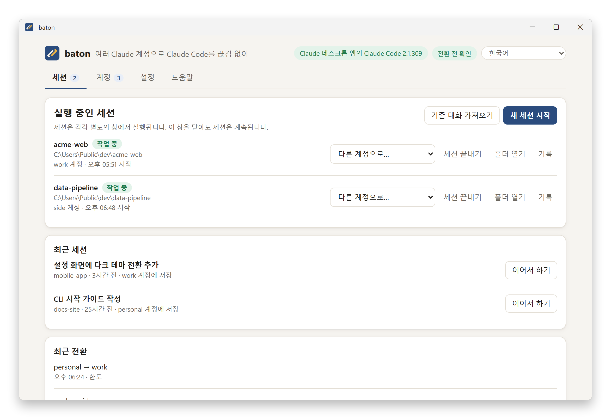
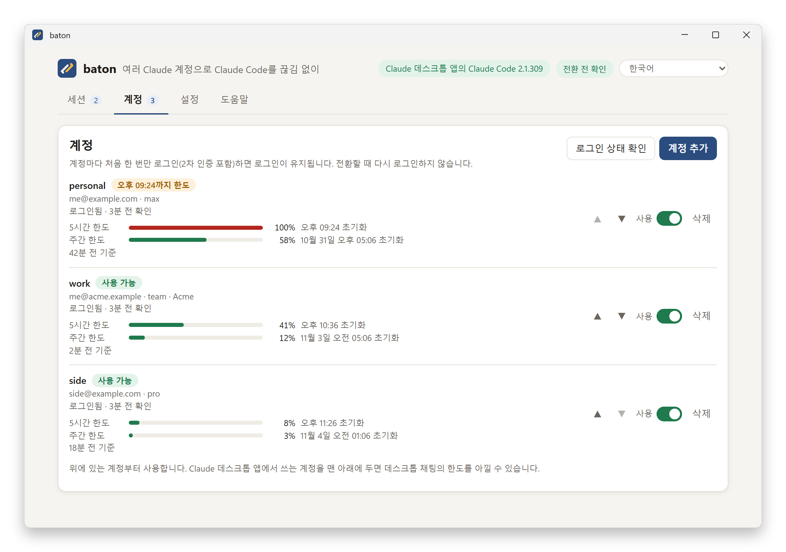
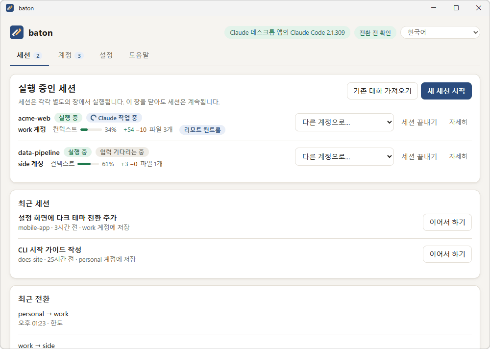
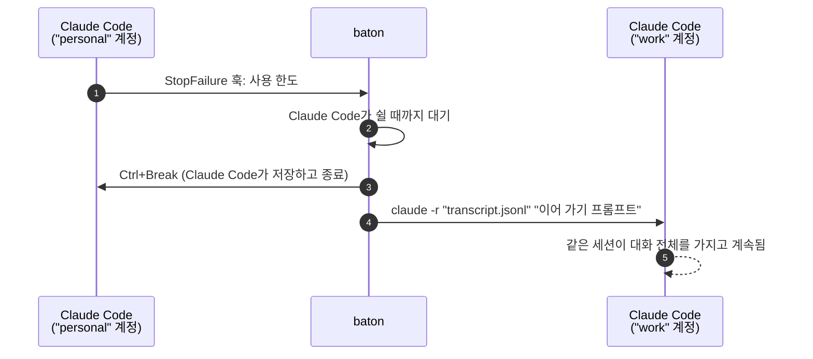

<div align="center">


# baton

**여러 개의 내 Claude 계정으로 Claude Code를 끊김 없이.**<br>
쓰던 계정이 사용 한도에 걸리면, baton이 로그인해 둔 다음 계정에서 *같은 대화*를 이어 갑니다.
내용을 복사하거나 처음부터 다시 설명할 필요가 없습니다.

[](../../releases/latest)


[](LICENSE)

[English](README.md) · **한국어**

[다운로드](../../releases/latest) ·
[시작하기](#시작하기) ·
[기존 대화 가져오기](#데스크톱-앱의-대화-가져오기) ·
[작동 방식](#작동-방식) ·
[명령줄](#명령줄) ·
[알아 둘 점](#알아-둘-점)

<br>


</div>

<br>

<picture>
  <source media="(prefers-color-scheme: dark)" srcset="docs/images/ko/sessions-dark.png">
  
</picture>

## 왜 baton인가

- 🔁 **같은 대화를 다음 계정에서.** 한도에 걸리면 baton이 Claude Code를 안전하게 멈추고, 다음 계정에서
  대화 전체를 가지고 다시 시작합니다. 한도에 걸린 그 질문도 사라지지 않습니다. 전환은 5~10초쯤 걸립니다.
- 🔐 **로그인은 계정마다 한 번.** 2단계 인증을 포함해 계정마다 처음 한 번만 로그인하면 로그인이 유지됩니다.
  로그인과 갱신은 Claude Code가 직접 하며, baton은 인증 정보를 읽거나 저장하지 않습니다.
- 🖥️ **Claude 데스크톱 앱 사용자를 위해.** 데스크톱 앱에 들어 있는 Claude Code를 그대로 쓰므로 따로
  설치할 것이 없습니다. 한국어와 영어 창을 제공합니다.
- 📥 **쓰던 대화를 그대로 가져오기.** 데스크톱 앱의 Code 탭, 터미널, VS Code에서 하던 세션을 골라
  baton에서 이어 갈 수 있습니다.
- 📊 **계정마다 한도를 한눈에.** 계정 탭에서 계정마다 5시간 한도와 주간 한도를 얼마나 썼는지, 언제
  초기화되는지 보여 줍니다. 세션 창에도 프롬프트 아래에 계정과 사용량이 나옵니다
  (`baton · work · 5시간 34% · 주간 12%`).
- 🎛️ **전환 방식은 내가 정합니다.** 전환할 때마다 묻거나, 알아서 전환하거나, 직접 지시할 때만 전환하게
  할 수 있습니다. 실행 중인 세션을 언제든 다른 계정으로 옮길 수도 있습니다.
- ⌨️ **명령줄도 함께.** `baton.exe`로 터미널과 스크립트에서 같은 기능을 쓸 수 있습니다.

> [!IMPORTANT]
> **본인 소유의 계정만** 쓰세요. Anthropic 약관과 이용 정책은 여러 계정으로 제한을 피하는 것도
> 금지합니다. 한도에 걸린 뒤 다른 계정으로 이어 쓰는 것이 바로 그런 행위로 판단될 수 있고, 계정이 예고
> 없이 정지될 수 있습니다. 전환을 켜기 전에 [알아 둘 점](#알아-둘-점)을 읽으세요.

## 시작하기

Windows 10/11의 Claude 데스크톱 앱 사용자 기준입니다.

1. [Releases](../../releases/latest)에서 `baton_<버전>_windows_amd64.zip`을 **받아 압축을 풉니다**
   (zip에서 마우스 오른쪽 → *모두 압축 풀기*). ARM 노트북(Snapdragon 등)은 `…_arm64.zip`을 받습니다.
2. **`baton-app.exe`를 엽니다.** 서명되지 않은 프로그램이라 처음에 "Windows의 PC 보호" 창이 뜰 수
   있습니다. *추가 정보 → 실행*을 누르세요.
3. **안내를 읽고** 계정 전환 방식을 고릅니다. *전환 전 확인*을 권장합니다.
4. **계정을 추가합니다.** 계정마다 브라우저에서 한 번 로그인합니다. 두 번째 계정부터는 브라우저가 첫
   계정으로 로그인되어 있을 수 있으니, 창의 안내대로 InPrivate 창에서 로그인하세요. 평소 브라우저의
   로그인은 그대로 둡니다.
5. **세션을 시작합니다.** 작업할 폴더를 고르면 Claude Code가 별도의 창에서 열리고, 작업은 그 창에서
   평소처럼 합니다. baton 창을 닫아도 세션은 계속됩니다.
6. *선택:* **도움말 → 시작 메뉴에 설치**를 누르면 시작 메뉴에서 열 수 있고, 업데이트한 뒤에도 작업
   표시줄 고정이 유지됩니다.

Claude 데스크톱 앱 자체의 로그인은 바뀌지 않습니다. baton의 계정들은 데스크톱 앱과 따로 로그인됩니다.

<picture>
  <source media="(prefers-color-scheme: dark)" srcset="docs/images/ko/accounts-dark.png">
  
</picture>

## 데스크톱 앱의 대화 가져오기

**기존 대화 가져오기**를 누르면 모든 폴더의 Claude Code 대화가 최신순으로 나옵니다. Claude 데스크톱
앱의 세션(앱에서 붙은 이름 그대로), 터미널과 VS Code에서 한 대화, baton 계정에 저장된 대화가 모두
포함됩니다. 대화를 고른 뒤 시작할 계정을 정하면, 그 대화를 하던 폴더에서 이어집니다.

<p align="center"></p>

- **어디에서도 열려 있지 않은 대화:** 그 대화 자체를 baton에서 이어 갑니다.
- **데스크톱 앱에서 아직 열려 있는 대화:** 두 곳에서 한 대화에 동시에 쓰면 대화가 깨지므로 **사본**으로
  이어 갑니다. 원래 대화는 데스크톱 앱에 그대로 남습니다. 사본은 지금까지의 내용을 모두 이어받은 새
  대화이고, 다른 세션처럼 계정을 전환합니다.
- **폴더가 없어진 대화:** 대화는 원래 폴더에서만 이어 갈 수 있으므로, 폴더가 없다고 표시합니다.

명령줄에서는 다음과 같이 합니다.

```bash
baton sessions
```

```bash
baton resume 2cd067ab-193c-4e56-baa2-0b34dc203160 --copy
```

## 작동 방식



- **계정마다 프로필 하나.** 계정마다 별도의 Claude Code 프로필(`CLAUDE_CONFIG_DIR`)을 씁니다.
  로그인과 갱신은 Claude Code가 직접 하므로, baton은 인증 정보를 읽거나 저장하거나 보내지 않습니다.
- **진짜 Claude Code.** `baton run`은 콘솔에서 대화형 `claude.exe`를 실행하고, 훅을 더한 설정 파일을
  넘깁니다. 응답이 사용 한도로 끝나면 `StopFailure` 훅이 baton에 알립니다.
- **깔끔한 전환.** baton은 Claude Code가 쉴 때까지 기다렸다가 Ctrl+Break로 멈춥니다. 그러면 Claude가
  대화 기록을 저장하고 정상 종료합니다. 이어서 baton이 다음 계정에서
  `claude -r "<transcript>" "<이어 가기 프롬프트>"`로 다시 시작합니다. 세션 id와 대화 파일은 그대로이고,
  새 계정은 한도에 걸린 질문까지 포함한 대화 전체를 받습니다.
- **창.** `baton-app.exe`는 작은 로컬 페이지를 자체 WebView2 창에 보여 줍니다. WebView2는 Windows
  11과 거의 모든 Windows 10에 들어 있고, 없으면 기본 브라우저에서 열립니다. 창은 로그인, 세션, 계정
  변경을 모두 `baton.exe`로 실행하므로 창과 명령줄이 같은 규칙을 따릅니다. 페이지는 127.0.0.1에서 그
  창에만 제공됩니다. 창 주소의 일회용 코드를 토큰으로 바꾸고, 모든 요청이 그 토큰을 헤더에 담아
  보냅니다(쿠키는 쓰지 않음). 페이지와 같은 출처에서 온 요청만 받습니다.

## 설치

릴리스 zip에는 `baton-app.exe`(창), `baton.exe`(명령줄, 둘을 같은 폴더에 두세요), README와 라이선스가
들어 있습니다. 받은 파일은 `checksums.txt`와 비교해 확인할 수 있습니다.

```bash
Get-FileHash baton_0.3.0_windows_amd64.zip -Algorithm SHA256
```

창의 **도움말 → 시작 메뉴에 설치**는 baton을 `%LOCALAPPDATA%\Programs\baton`에 복사합니다. 명령줄을
어디서나 쓰려면 그 폴더(또는 압축을 푼 폴더)를 `PATH`에 추가하세요.

**Claude Code.** Claude Code CLI가 설치되어 있으면 그것을 쓰고, 없으면 Claude 데스크톱 앱에 들어 있는
것을 씁니다. 데스크톱 앱 쪽은 앱의 Code 탭을 한 번 열면 생깁니다. `baton config allow_desktop_bundle false`로
끌 수 있습니다. CLI를 설치하려면 다음을 실행합니다.

```bash
powershell -c "irm https://claude.ai/install.ps1 | iex"
```

<details>
<summary><b>소스에서 빌드</b> (Go 1.27+)</summary>

```bash
go build -trimpath -o bin/baton.exe ./cmd/baton
```

```bash
go build -trimpath -ldflags "-H windowsgui -X main.guiBuild=1" -o bin/baton-app.exe ./cmd/baton
```

릴리스 zip(x64와 arm64, 체크섬 포함)은 다음 명령으로 만듭니다. 이때 `dist\`에는 그 파일들만 남습니다.

```bash
powershell -NoProfile -ExecutionPolicy Bypass -File scripts\build.ps1 -Version 0.3.0
```

아이콘, 매니페스트, 버전 리소스는 `go run ./tools/winres -version <v>`로 다시 만듭니다.

</details>

## 명령줄

```bash
baton add personal        # 이 계정의 Claude 로그인 열기
baton add work            # 내 계정마다 반복
baton list
baton run                 # baton으로 Claude Code 시작
```

```text
> baton run
  ... 평소처럼 Claude Code로 작업 ...
  ... 계정이 한도에 걸림 ...
baton: usage limit on "personal" (resets 15:00) -> continuing on "work"
  ... 같은 세션이 "work"에서 대화 전체를 가지고 계속됨 ...
```

처음 `baton run`을 실행할 때 전환 방식을 고릅니다. `auto`는 묻지 않고 전환하고, `confirm`은 전환할
때마다 묻고, `off`는 `baton switch`로만 전환합니다.

Claude Code 옵션과 첫 질문은 `--` 뒤에 넘기고, 계정은 `--account`로 고릅니다.

```bash
baton run -- --model opus --permission-mode plan
```

```bash
baton run --account work -- -r "C:\path\to\session.jsonl"
```

넘긴 옵션은 전환할 때마다 그대로 유지됩니다. 단, 시작할 때만 쓰는 옵션은 예외입니다. 열 세션을 정하는
`-r`, `-c`, `--session-id`, `--fork-session`과 `--file`이 그렇습니다.

권한 모드는 세션을 따라갑니다. 전환하면 baton은 세션이 마지막에 쓰던 모드로 다음 계정을 시작합니다.
Claude Code만으로는 그 계정의 기본 모드로 돌아갑니다. 예를 들어 `--dangerously-skip-permissions`로
시작해 어느 계정에서든 경고에 한 번 동의했다면, baton이 그 동의를 다음 계정에도 넘겨 세션이 경고에서
멈추지 않습니다. 그사이 Shift+Tab으로 우회 모드를 벗어났다면, 다음 계정은 쓰던 모드로 시작하고 우회
모드도 계속 고를 수 있습니다.

`--add-dir a b`처럼 값을 여러 개 받는 옵션보다 질문을 앞에 두세요. Claude Code는 그런 옵션 뒤의 단어를
모두 옵션 값으로 읽습니다.

| 명령 | 하는 일 |
|---|---|
| `baton gui` | 창 열기 (`baton-app.exe`를 여는 것과 같음) |
| `baton add <이름> [--email <주소>] [--priority N]` | 계정 프로필을 만들고 Claude 자체 로그인으로 로그인 (`--email`은 로그인 페이지에 미리 채움) |
| `baton login <이름> [--email <주소>]` | 계정을 다시 로그인. 예를 들어 `baton list`가 `needs_login`을 보일 때. 그 계정에서 세션이 실행 중이면 거절 |
| `baton list` | 계정과 요금제, 상태(`ok`, `limited until …`, `needs_login`, `blocked`), 마지막으로 확인한 사용량 보기 |
| `baton enable` / `disable <이름>` | 계정을 쓰거나 건너뛰기 (`enable`은 `blocked` 표시도 지움) |
| `baton remove <이름> [--force]` | 로그아웃하고 프로필 삭제 (그 계정에서 시작한 대화가 있으면 거절) |
| `baton run [--account <이름>] [-- <claude 인수>]` | baton이 지켜보는 세션 시작 |
| `baton sessions [--max N]` | 데스크톱 앱 것을 포함해 모든 폴더의 대화 보기 |
| `baton resume <id> [--account <이름>] [--copy]` | 그중 하나를 그 폴더에서 이어 가기 (`--copy`는 원래 대화를 그대로 둠) |
| `baton switch [<이름>] [--run <id>]` | 다른 터미널에서, 실행 중인 세션을 현재 응답이 끝난 뒤 다른 계정으로 옮기기 |
| `baton stop [--run <id>]` | 실행 중인 세션을 안전하게 끝내기. 나중에 이어 갈 수 있음 |
| `baton status` | 계정, 실행 중인 세션, 최근 전환 보기 |
| `baton sync` | 평소 Claude Code 설정을 모든 계정 프로필과 공유 (아래 참고) |
| `baton config [<키> [<값>]]` | 설정 보기와 바꾸기 (아래 참고) |
| `baton doctor` | claude.exe, 콘솔, 모든 로그인 점검 |
| `baton uninstall [--yes]` | 모든 계정을 로그아웃하고 baton 데이터와 시작 메뉴 항목 삭제 |

**설정** (`baton config`):

| 키 | 뜻 |
|---|---|
| `switch_mode` | `auto`, `confirm`, `off` |
| `on_exhausted` | 모든 계정이 한도일 때 할 일: `wait` 또는 `stop` |
| `cooldown_seconds` | 전환 사이의 최소 간격 |
| `max_switches_per_hour` | 한 시간에 할 수 있는 최대 전환 횟수 |
| `exhausted_retry_minutes` | 한도 메시지에 풀리는 시각이 없을 때 기다릴 시간 |
| `continue_prompt` | 다음 계정이 받는 이어 가기 프롬프트 |
| `share_user_config` | 평소 Claude Code 설정을 프로필과 공유 (기본값 `true`) |
| `claude_path` | `claude.exe`의 전체 경로. `desktop`이면 항상 Claude 데스크톱 앱의 것을 쓰고, `auto`로 하면 다시 자동으로 찾음 |
| `allow_desktop_bundle` | 데스크톱 앱에 들어 있는 Claude Code 사용 허용 |

<details>
<summary><b>모든 계정에서 내 Claude Code 설정 쓰기</b></summary>

계정마다 별도의 Claude Code 프로필이므로, baton은 프로필에서 Claude Code를 시작하기 전에 평소 설정
(`%USERPROFILE%\.claude`)을 공유합니다.

- `agents`, `commands`, `skills`, `output-styles`는 연결(NTFS 정션)합니다.
- `settings.json`, `CLAUDE.md`, `keybindings.json`은 복사합니다. 프로필 안에서 직접 고친 파일은
  덮어쓰지 않습니다.
- 로그인 관련 설정(`apiKeyHelper`, API 키나 공급자 환경 변수)은 복사하지 않습니다. 그래서 계정 자체의
  로그인을 덮어쓰지 않습니다.
- 플러그인, MCP 서버, 인증 정보는 공유하지 않습니다.

`baton sync`로 모든 프로필을 새로 고치고, `baton config share_user_config false`로 공유를 끕니다.

</details>

<details>
<summary><b>이어 하기</b></summary>

`baton run -- -r <세션 id>`는 세션이 어디에 저장되어 있든 찾습니다. 어느 계정의 프로필이든, baton 이전의
대화라면 평소 Claude Code 설정(`%USERPROFILE%\.claude`)이든 찾으므로 어떤 대화든 어느 계정에서나 이어 갈
수 있습니다. `baton run -- -c`는 그 모든 곳을 통틀어 현재 폴더의 가장 최근 대화를 이어 갑니다.

Claude Code가 끝나면 baton은 언제나 통하는 `baton run -- -r "<transcript>"` 명령을 보여 줍니다. Claude
Code가 보여 주는 `claude --resume <id>`는 그 대화를 시작한 계정에서만 통합니다.

baton의 데이터는 `%LOCALAPPDATA%\baton`에 있습니다(`BATON_HOME`으로 바꿀 수 있음).

- `accounts.json`, `state.json`, `config.json`
- `profiles\<이름>\`: 계정마다의 Claude Code 프로필
- `runs\<id>\`: 세션마다의 훅 이벤트와 기록
- `logs\gui.log`: 창 자체의 기록

</details>

## 알아 둘 점

- **전환을 켜기 전에 꼭 읽으세요.** 본인 소유의 계정만 쓰세요. 여러 사람이 계정을 함께 쓰는 것은
  Anthropic 약관 위반입니다. Anthropic 이용 정책은 허가 없이 제품의 제한을 의도적으로 우회하는 것과, 여러
  계정으로 안전장치를 피하는 것도 금지합니다. 한도에 걸린 뒤 다른 계정으로 이어 쓰는 것이 바로 그런
  행위로 판단될 수 있고, Anthropic은 계정을 예고 없이 정지할 수 있습니다. 이를 허용한다는 Anthropic의
  공식 입장은 없으니 본인 판단과 책임으로 사용하세요. baton은 처음 자동 전환하기 전에 이 안내를 보여 주고
  동의를 받습니다.
- **문제가 생긴 계정에서는 전환하지 않습니다.** 계정이 보류되거나, 결제에 문제가 있거나, 로그인이
  취소될 수 있습니다. 그러면 baton은 그 계정에서 다른 계정으로 넘어가지 않습니다. 그 세션에서 오류를 볼
  수 있도록 하고, 계정을 `blocked`로 표시합니다(Claude Code가 끝날 때 알려 줌). baton은 blocked 계정을
  자동으로 쓰지 않습니다. 문제가 해결되면 `baton enable <이름>`이나 성공한 `baton login <이름>`이 표시를
  지웁니다.
- **세션 안에서는 계정을 바꾸는 명령이 거절됩니다.** `baton switch`, `add`, `login`, `remove`, `sync`,
  `config …`는 baton이 지켜보는 세션 안에서 실행하면 거절됩니다. 그 세션의 모델이 세션을 옮기기 어렵게
  하려는 장치일 뿐 보안 경계는 아닙니다. 세션은 사용자 권한으로 실행되기 때문입니다.
- **확인 모드는 세션 창에서 묻습니다.** `confirm` 모드에서는 `baton switch`로 요청한 전환을 포함해 모든
  전환을 그 세션의 콘솔 창에서 확인해야 합니다. baton 앱 창에서는 묻지 않습니다. Enter는 예이고,
  Ctrl+C는 baton을 끝냅니다. 실행 중인 세션은 *더 엄격한* 전환 방식만 따라갑니다(auto → confirm → off).
  더 느슨한 방식은 다음 `baton run`부터 적용됩니다.
- **전환은 현재 응답을 기다립니다.** `baton switch`는 Claude Code가 하던 응답을 최대 1분까지 끝내게
  합니다. 그 뒤에는 baton이 중단하고 다음 계정이 작업을 다시 이어받습니다. `confirm` 모드에서는 어차피
  묻기 때문에 최대 30분 기다립니다. 그동안 `baton status`는 세션을 `stopping`으로 보여 주고, 다른
  `baton switch <이름>`으로 대상을 바꿀 수 있습니다.
- **전환할 때마다 새 계정의 한도를 씁니다.** 프롬프트 캐시는 계정마다 따로라서 다음 계정이 대화 전체를
  다시 읽습니다. 긴 세션에는 `/compact`가 도움이 됩니다.
- **Claude Code와 함께 다시 시작되는 것이 있습니다.** 백그라운드 셸과 MCP 서버 상태는 새로 시작되고,
  위쪽 화살표 입력 기록과 `/rewind` 체크포인트는 프로필마다 따로입니다.
- **전환되는 5~10초 동안 입력한 키는 사라질 수 있습니다.**
- **로그인 실패는 먼저 재시도합니다.** 로그인에 실패하면 Claude Code가 먼저 스스로 최대 10번
  재시도하므로, baton은 그 뒤에 넘어갑니다. 529 "overloaded" 오류로는 절대 전환하지 않습니다.
- **프로필마다 처음 시작할 때 약 15 MB를 받습니다.** Claude Code의 공식 플러그인 마켓플레이스이며,
  Claude Code는 새 프로필마다 이것을 받습니다.
- **대화는 그 대화를 시작한 계정에 저장됩니다.** 그 계정을 삭제하면 그 대화도 지워지므로,
  `baton remove`는 `--force` 없이는 거절합니다.
- **baton 세션만 전환됩니다.** baton 창이나 `baton run`으로 시작한 세션만 계정을 전환합니다. 창에서
  시작한 세션도 자기 콘솔에서 실행되는 `baton run`입니다. 데스크톱 앱의 Code 탭이나 IDE 확장에서 실행
  중인 세션은 전환되지 않으니, 위의 *기존 대화 가져오기*로 가져와 쓰세요.
- **세션은 데스크톱 앱이 아니라 Claude Code 창에서 열립니다.** baton은 세션을 계정 사이에서 옮기기 위해
  Claude Code를 직접 실행합니다. Claude 데스크톱 앱에는 앱 자체의 로그인이 하나 있고, baton은 그것을
  건드리지 않습니다. *설정 → 고급 설정 → 사용할 Claude Code*는 어떤 `claude.exe`(설치된 CLI 또는 데스크톱
  앱에 들어 있는 것)를 실행할지만 정합니다.
- **사용량은 세션에서 옵니다.** Claude Code는 (Claude 구독 계정이면) 계정의 5시간·주간 사용량을 세션의
  상태 표시줄에 넘겨 주고, baton의 상태 표시줄이 그것을 기록합니다. 그래서 그 계정으로 baton 세션을 한 번
  쓴 뒤부터, 그 시점 기준으로 표시됩니다. baton이 Anthropic에 따로 묻지는 않습니다. 직접 설정한 상태
  표시줄(설정의 `statusLine`)이 있으면 baton은 그대로 두고, 그 세션의 사용량은 기록하지 않습니다.
- **Windows 콘솔에서 실행하세요.** Windows Terminal, PowerShell, cmd에서 실행하세요. mintty(ConPTY 없이)
  처럼 Windows 콘솔이 아닌 터미널에서 실행하면 Claude Code를 새 콘솔 창에서 엽니다.

## 제거

창에서 **도움말 → baton 제거**를 누르거나, 명령줄에서 다음을 실행합니다.

```bash
baton uninstall
```

제거 프로그램은 Claude Code로 모든 계정을 로그아웃하고 baton 데이터 폴더(`%LOCALAPPDATA%\baton`)를
지웁니다. 이 폴더에는 계정마다의 프로필과 거기서 시작한 대화가 들어 있습니다. 시작 메뉴 항목, Windows
설치된 앱 목록의 항목, 설치 폴더도 지웁니다. 실행 중인 세션은 먼저 끝내세요. Claude 계정 자체와 평소
쓰던 Claude Code 설정은 건드리지 않습니다.

프로필이 남아 있을 때는 폴더 링크를 따라가는 도구로 `%LOCALAPPDATA%\baton`을 직접 지우지 마세요.
프로필이 `%USERPROFILE%\.claude`로 연결되어 있기 때문입니다. baton의 제거 기능은 링크를 따라가지
않습니다.

## 개발

```bash
go test ./...
```

```bash
go build -trimpath -o bin/baton.exe ./cmd/baton
```

```bash
python -I test/e2e/e2e_baton.py <빈 폴더>
```

```bash
go build -tags batontest -o bin/baton-test.exe ./cmd/baton
```

첫 명령은 단위 테스트입니다. 세 번째 명령인 종단 간 테스트는 실제 계정 없이, `spikes/phase0/harness`의
가짜 Messages API를 상대로 ConPTY에서 진짜 `baton.exe`와 `claude.exe`를 실행합니다. 다루는 내용은 다음과
같습니다.

- 전환: 자동, 수동, 확인 모드, 그리고 전환 전에 응답 기다리기
- 모든 계정이 한도에 걸린 경우
- 전환하면 안 되는 오류: 일시적 제한, 과부하, 결제 차단
- 전환해야 하는 로그인 실패
- `/clear`, 그리고 계정을 넘나드는 id로 이어 하기
- 다른 곳에서 열려 있는 대화를 사본으로 가져오기
- 세션의 baton 상태 표시줄, 그리고 직접 설정한 상태 표시줄은 그대로 두기
- 설정 공유와 질문 중 Ctrl+C
- `baton stop`(질문 중이거나 전환을 기다리는 중일 때 포함)

창의 서버는 `internal/gui`에 자체 단위 테스트가 있습니다. 마지막 명령으로 만드는 테스트 빌드에는
`baton gui --no-window --test-spawn`이 추가되며, 이 명령은 브라우저용 페이지를 띄웁니다. 이때 로그인은
가짜 claude로 숨겨서 실행하고, 세션은 기록만 합니다. 설계가 기대는 Claude Code 동작의 검증 결과는
`spikes/phase0/RESULTS.md`에 있습니다.

## 라이선스

MIT 라이선스입니다([LICENSE](LICENSE)). baton은 Go 표준 라이브러리와 `golang.org/x/sys`(BSD-3-Clause)를
포함하며, 그 고지는 [THIRD_PARTY_NOTICES.txt](THIRD_PARTY_NOTICES.txt)에 있습니다. baton은 Anthropic이
만들거나 Anthropic과 관련된 프로젝트가 아닙니다.
