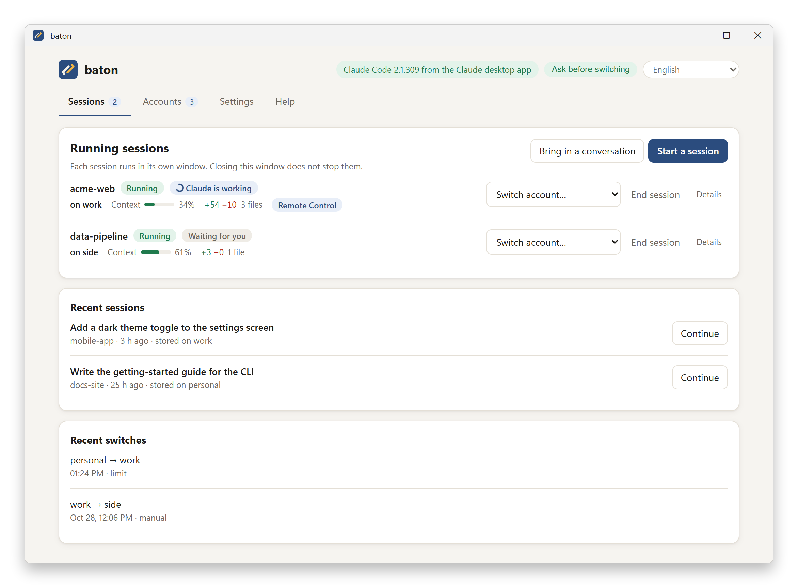
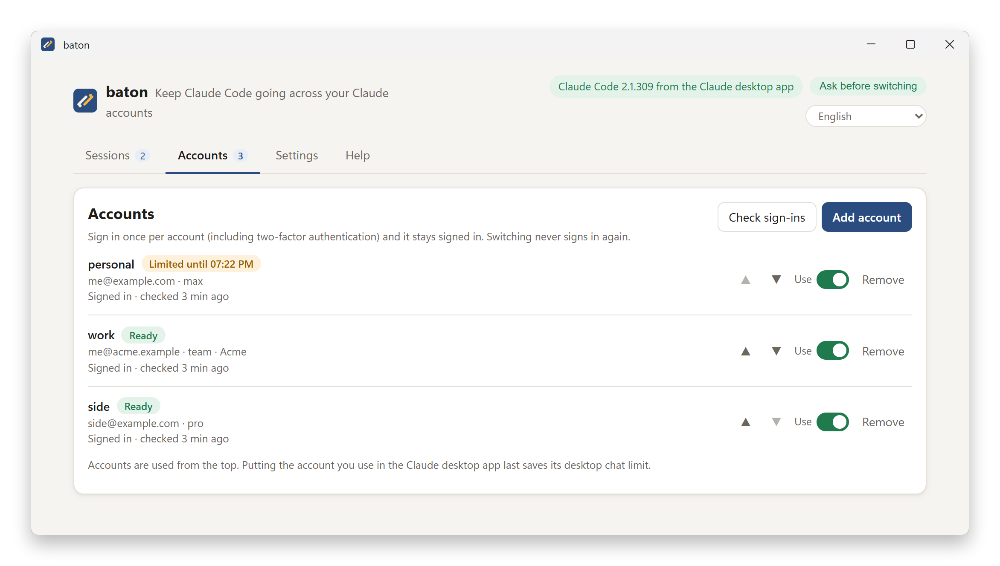
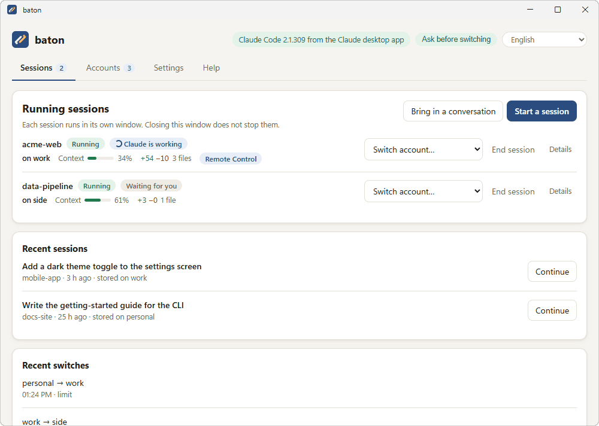
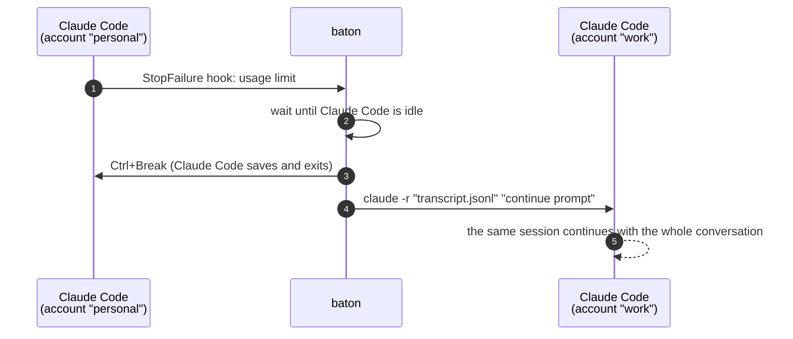

<div align="center">


# baton

**Keep Claude Code going across your own Claude accounts.**<br>
When the account in use hits its usage limit, baton continues the *same conversation*
on your next signed-in account. You don't need to copy anything or explain it again.

[](../../releases/latest)


[](LICENSE)

**English** · [한국어](README.ko.md)

[Download](../../releases/latest) ·
[Getting started](#getting-started) ·
[Bring in a conversation](#bring-in-a-conversation-from-the-desktop-app) ·
[How it works](#how-it-works) ·
[Command line](#command-line) ·
[Things to know](#things-to-know)

<br>



</div>

<br>

<picture>
  <source media="(prefers-color-scheme: dark)" srcset="docs/images/sessions-dark.png">
  
</picture>

## Why baton

- 🔁 **Same conversation, next account.** baton stops Claude Code cleanly at the limit and
  starts it again on the next account with the whole conversation. The prompt that hit
  the limit is not lost. A switch takes about 5–10 seconds.
- 🔐 **Sign in once per account.** Each account signs in once (two-factor authentication
  included) and stays signed in. Claude Code itself signs in and refreshes each account,
  and baton never reads or stores credentials.
- 🖥️ **Made for Claude desktop app users.** baton uses the Claude Code that comes with the
  desktop app, so there is nothing else to install. It has a window in English and Korean.
- 📥 **Bring in conversations you already have.** Pick a session from the desktop app's
  Code tab, a terminal or VS Code and continue it under baton.
- 📊 **See each account's limits.** The Accounts tab shows how much of the 5-hour and
  weekly limits each account has used and when they reset, and every session shows its
  account and usage under the prompt (`baton · work · 5h 34% · week 12%`).
- 👀 **See what each session is doing.** The Sessions tab shows whether Claude is working,
  waiting for you or needs an answer in the session window, plus the model, how full the
  context is and the files changed in the folder (with a list of them, like the desktop app's
  changes panel).
- 🔔 **Know when a session needs you.** A Windows notification says when a session switched
  accounts, every account is limited, it needs your answer in its window or a long response is
  done; clicking it brings up that session's window, as *Show window* in the Sessions tab does.
  While Claude works, the PC does not go to sleep by itself.
- ♻️ **Pick up after a restart.** When Windows restarts or a session is cut off, the Sessions
  tab offers to reopen it as it was; a session that was working carries on with its task.
- 📱 **Remote Control.** Turn it on when you start a session to see and continue it from the
  Claude app on your phone or from claude.ai/code. It comes back on by itself after a switch.
- 🎛️ **You decide when it switches.** baton can ask before every switch, switch on its own,
  or switch only when you tell it to. You can also move a session to another account at
  any time.
- 🧭 **Keep a folder on its account.** A folder rule keeps the sessions in a folder (and the
  folders under it) on the accounts you choose, so a company repository can stay on the
  company account.
- ⌨️ **Command line included.** `baton.exe` has the same features for terminals and
  scripts.
- ⬆️ **Updates in one click.** baton tells you when a new release is out and installs it
  from GitHub after checking its checksum.

> [!IMPORTANT]
> Use only accounts you personally own. Anthropic's terms and Usage Policy also forbid
> using several accounts to get around its limits. Continuing past a usage limit on
> another account may count as exactly that, and accounts can be suspended without
> notice. See [Things to know](#things-to-know) before you turn switching on.

## Getting started

For Claude desktop app users on Windows 10/11.

1. **Download** `baton_<version>_windows_amd64.zip` from [Releases](../../releases/latest)
   and **unzip** it (right-click → *Extract All*). ARM laptops (Snapdragon and similar)
   use `…_arm64.zip`.
2. **Open `baton-app.exe`.** Windows may show *"Windows protected your PC"* the first time,
   because the program is not signed. Choose *More info → Run anyway*.
3. **Read the notice** and choose how baton switches accounts. *Ask before switching* is
   recommended.
4. **Add your accounts.** Each one signs in once in your browser. From the second account
   on, your browser may still be signed in to the first one, so keep *My browser is already
   signed in to another Claude account* checked (it is, once an account is signed in): the
   sign-in page then opens in an InPrivate window, and your normal browser sign-in stays as
   it is.
5. **Start a session.** Choose a project folder. Claude Code opens in its own window, and
   you work there as usual. You can close the baton window; sessions keep running.
6. *Optional:* **Help → Install to the Start menu** adds baton to the Start menu, and a
   taskbar pin keeps working after updates.

The Claude desktop app's own sign-in does not change. baton's accounts are signed in
separately from the app.

<picture>
  <source media="(prefers-color-scheme: dark)" srcset="docs/images/accounts-dark.png">
  
</picture>

## Bring in a conversation from the desktop app

**Bring in a conversation** lists your Claude Code conversations from every folder,
newest first. It covers sessions from the Claude desktop app (under the names the app
gave them), from a terminal or VS Code, and the ones stored on baton's accounts. Choose
one, then choose the account to start on. The conversation continues in its own folder.

<p align="center"></p>

- **Not open anywhere:** the conversation itself continues under baton.
- **Still open in the desktop app or a terminal:** baton says where it is open and asks you
  to close it there first: quit the desktop app completely (from the tray icon too), or end
  Claude Code in that terminal. Then choose *Check again*. Writing to one conversation from
  two places would corrupt it, so if you go on while it is still open, baton continues in a
  **copy**. The original stays as it is. The copy is a new conversation that carries
  everything said so far, but from then on the two go separate ways.
- **Its folder is gone:** baton shows that, because it can only continue a conversation
  in its own folder.

A conversation brought in without a copy is the same conversation on both sides: baton and
the desktop app read and write the same file. Hand it over one side at a time. End the
session in baton before you open the conversation in the desktop app, and quit the desktop
app before you bring it in again; whichever side opens it next continues from everything
said on the other.

From the command line:

```bash
baton sessions
```

```bash
baton resume 2cd067ab-193c-4e56-baa2-0b34dc203160 --copy
```

## How it works



- **One profile per account.** Each account is its own Claude Code profile
  (`CLAUDE_CONFIG_DIR`). Claude Code signs it in and refreshes it, so baton never reads,
  stores or sends credentials.
- **The real Claude Code.** `baton run` starts the interactive `claude.exe` in your
  console with a settings file that adds hooks. When a turn ends on a usage limit, the
  `StopFailure` hook tells baton.
- **A clean switch.** baton waits until Claude Code is idle and stops it with Ctrl+Break,
  so Claude saves the transcript and exits normally. Then baton starts it on the next
  account with `claude -r "<transcript>" "<continue prompt>"`. The session id and
  transcript file stay the same. The new account receives the whole conversation,
  including the prompt that hit the limit.
- **The window.** `baton-app.exe` shows a small local page in a WebView2 window of its
  own. WebView2 ships with Windows 11 and almost every Windows 10; without it, the page
  opens in your default browser. The window runs `baton.exe` for sign-ins, sessions and
  account changes, so the window and the command line follow the same rules. The page is
  served on 127.0.0.1 to that window only. A one-time code in the window's address is
  exchanged for a token that every request carries in a header (no cookies), and every
  request must come from the page's own origin.

## Install

The release zip contains `baton-app.exe` (the window), `baton.exe` (the command line; keep
both in the same folder), the READMEs and the licenses. You can check a download against
`checksums.txt`:

```bash
Get-FileHash baton_0.6.1_windows_amd64.zip -Algorithm SHA256
```

**Help → Install to the Start menu** in the window copies baton to
`%LOCALAPPDATA%\Programs\baton`. To use the command line from anywhere, put that folder
(or the unzipped one) on your `PATH`.

**Updating.** **Help → Update baton** asks GitHub for the newest release and shows what
changed; while the window is open it also looks every few hours and shows a banner when one
is out. *Update to …* downloads the release, checks it against the release's
`checksums.txt`, installs it to the Start menu and opens the new window. End running sessions
and close the windows baton opened first. From the command line:

```bash
baton update
```

**Claude Code.** baton uses the Claude Code CLI if it is installed, and otherwise the copy
that comes with the Claude desktop app. That copy appears after you open the app's Code tab
once. `baton config allow_desktop_bundle false` turns that off. To install the CLI:

```bash
powershell -c "irm https://claude.ai/install.ps1 | iex"
```

<details>
<summary><b>Build from source</b> (Go 1.27+)</summary>

```bash
go build -trimpath -o bin/baton.exe ./cmd/baton
```

```bash
go build -trimpath -ldflags "-H windowsgui -X main.guiBuild=1" -o bin/baton-app.exe ./cmd/baton
```

For a release, write its notes in `docs/releases/v<version>.md` first, then run the command below. It builds the zips (x64 and arm64) and `checksums.txt`, plus `RELEASE_NOTES.md`, the notes with the checksums for the release page. `dist\` then holds only those:

```bash
powershell -NoProfile -ExecutionPolicy Bypass -File scripts\build.ps1 -Version 0.6.1
```

`go run ./tools/winres -version <v>` regenerates the icon, manifest and version resources.

</details>

## Command line

```bash
baton add personal        # opens Claude's sign-in for this account
baton add work --private  # each further account, in an InPrivate window
baton list
baton run                 # start Claude Code under baton
```

```text
> baton run
  ... you work in Claude Code as usual ...
  ... the account hits its limit ...
baton: usage limit on "personal" (resets 15:00) -> continuing on "work"
  ... the same session continues on "work", with the whole conversation ...
```

On the first `baton run` you choose a switch mode: `auto` (switch without asking),
`confirm` (ask before each switch) or `off` (switch only with `baton switch`).

Pass Claude Code options, and a first prompt, after `--`. Use `--account` to choose the
account:

```bash
baton run -- --model opus --permission-mode plan
```

```bash
baton run --account work -- -r "C:\path\to\session.jsonl"
```

Options you pass are kept on every switch, except the start-only ones: the session to open
(`-r`, `-c`, `--session-id`, `--fork-session`) and `--file`.

The permission mode follows the session. After a switch, baton starts the next account in
the mode the session was last in; Claude Code alone would fall back to the account's
default. Suppose you started with `--dangerously-skip-permissions` and accepted Claude
Code's warning once on any account. baton then carries that acceptance to the next account,
so the session does not stop on the warning. If you left bypass mode meanwhile (Shift+Tab),
the next account starts in the mode you were in, with bypass still available.

Put your prompt before options that take several values, such as `--add-dir a b`, because
Claude Code reads every word that follows as one of their values.

| Command | What it does |
|---|---|
| `baton gui` | open the window (the same as opening `baton-app.exe`) |
| `baton add <name> [--email <address>] [--priority N] [--private]` | create an account profile and sign in with Claude's own login (`--email` fills in the sign-in page; `--private` opens it in an InPrivate window, for when your browser is signed in to another Claude account) |
| `baton login <name> [--email <address>] [--private]` | sign an account in again, for example when `baton list` shows `needs_login`; refuses while a session runs on it |
| `baton list` | show accounts, their plan, status (`ok`, `limited until …`, `needs_login`, `blocked`) and last known usage |
| `baton enable` / `disable <name>` | include or skip an account (`enable` also clears a `blocked` mark) |
| `baton remove <name>` | log out and delete the profile; its conversations are moved to your own Claude Code first |
| `baton run [--account <name>] [-- <claude args>]` | start a supervised session |
| `baton run --restore <run>` | reopen a session that was cut off (`baton status` lists them) |
| `baton sessions [--max N]` | list your conversations in every folder, the desktop app's included |
| `baton resume <id> [--account <name>] [--copy]` | continue one of them in its folder (`--copy` leaves the original as it is) |
| `baton switch [<name>] [--run <id>]` | from another terminal, move a running session to another account once its current turn ends |
| `baton stop [--run <id>]` | end a running session the careful way; you can continue it later |
| `baton status` | show accounts, running sessions, sessions that were cut off and recent switches |
| `baton sync` | share your normal Claude Code setup with every account profile (see below) |
| `baton config [<key> [<value>]]` | show or change settings (below) |
| `baton rules [set <folder> <account>[,<account>...] \| remove <folder>]` | show, add or remove folder rules (see Things to know) |
| `baton doctor` | check claude.exe, the console and every sign-in |
| `baton update [--check]` | install the newest baton from GitHub (`--check` only says whether one is out) |
| `baton uninstall [--yes]` | move baton's conversations to your own Claude Code, sign every account out and delete baton's data and its Start menu entry |

**Settings** (`baton config`):

| Key | Meaning |
|---|---|
| `switch_mode` | `auto`, `confirm` or `off` |
| `on_exhausted` | what to do when every account is limited: `wait` or `stop` |
| `cooldown_seconds` | minimum time between switches |
| `max_switches_per_hour` | upper limit on switches per hour |
| `exhausted_retry_minutes` | how long to wait when the limit message has no reset time |
| `continue_prompt` | the prompt the next account receives |
| `share_user_config` | share your normal Claude Code setup with the profiles (default `true`) |
| `claude_path` | full path to `claude.exe`; `desktop` always uses the Claude desktop app's; `auto` goes back to detecting it |
| `allow_desktop_bundle` | allow the Claude Code that comes with the desktop app |
| `remote_control` | tick *Turn on Remote Control* in the window's Start dialog by default |
| `notifications` | Windows notifications from sessions: `all` (default), `important` (all but finished responses) or `off` |
| `keep_awake` | keep the PC from sleeping by itself while a session works or waits for a limit to reset (default `true`) |
| `check_updates` | let the window look for a newer baton on GitHub every few hours (default `true`) |

<details>
<summary><b>Your Claude Code setup on every account</b></summary>

Each account is a separate Claude Code profile. Before baton starts Claude Code in a
profile, it shares your normal setup (`%USERPROFILE%\.claude`) with it:

- `agents`, `commands`, `skills` and `output-styles` are linked (NTFS junctions).
- `settings.json`, `CLAUDE.md` and `keybindings.json` are copied. A file you edit inside a
  profile is never overwritten.
- Sign-in settings (`apiKeyHelper` and API-key or provider environment variables) are left
  out of the copy, so they cannot override the account's own sign-in.
- Plugins, MCP servers and credentials are not shared.

Run `baton sync` to refresh every profile. To turn sharing off, run
`baton config share_user_config false`.

</details>

<details>
<summary><b>Resuming</b></summary>

`baton run -- -r <session id>` finds the session wherever it is stored: in any account's
profile, or in your normal Claude Code setup (`%USERPROFILE%\.claude`) for conversations
from before baton. So you can resume any conversation on any account. `baton run -- -c`
continues the most recent conversation in the current folder from any of those places.

When Claude Code exits, baton prints a `baton run -- -r "<transcript>"` command that always
works. Claude Code's own `claude --resume <id>` hint only works on the account that started
the conversation.

baton keeps its data in `%LOCALAPPDATA%\baton` (`BATON_HOME` changes this):

- `accounts.json`, `state.json` and `config.json`
- `profiles\<name>\`: each account's own Claude Code profile
- `runs\<id>\`: hook events and a log for each session
- `logs\gui.log`: the window's own log

</details>

## Things to know

- **Read this before turning switching on.** Only use accounts you personally own.
  Sharing an account between people is against Anthropic's terms. Anthropic's Usage
  Policy also prohibits intentionally bypassing restrictions in its products without
  permission, and using multiple accounts to get around its safeguards. Continuing past a
  usage limit on another account may be treated as exactly that, and Anthropic can suspend
  accounts without notice. No Anthropic source says this use is allowed, so you decide at
  your own risk. baton shows this notice and asks before the first automatic switch.
- **Problem accounts stay put.** An account can be put on hold, have a billing problem or
  have its sign-in revoked. baton then does not switch away from it, so you can see the
  error in that session, and it marks the account `blocked` (baton says so when Claude Code
  exits). baton never uses a blocked account automatically. Once the problem is resolved,
  `baton enable <name>` or a successful `baton login <name>` clears the mark.
- **Account changes refuse to run inside a session.** `baton switch`, `add`, `login`,
  `remove`, `sync` and `config …` refuse to run from inside a supervised session. This makes
  it harder for the model in that session to move it, but it is not a security boundary,
  because the session runs as you.
- **Confirm mode asks in the session's window.** In `confirm` mode every switch needs your
  answer in that session's own console window, even one you asked for with `baton switch`.
  The baton app window does not ask. Enter means yes, and Ctrl+C stops baton. A running
  session only ever picks up a *stricter* switch mode (auto → confirm → off); a looser mode
  applies from the next `baton run`.
- **A switch waits for the current turn.** `baton switch` lets Claude Code finish the turn
  it is working on, for up to a minute; after that baton interrupts it, and the next account
  picks the task up again. In `confirm` mode baton waits up to 30 minutes, since you are
  asked anyway. Meanwhile `baton status` shows the session as `stopping`, and another
  `baton switch <name>` changes the target.
- **Each switch costs quota on the new account.** Prompt caches are per account, so the
  next account reads the whole conversation again. Running `/compact` helps long sessions.
- **Some things restart with Claude Code.** Background shells and MCP server state start
  over, and up-arrow prompt history and `/rewind` checkpoints are per profile.
- **Keys you type during the 5–10 seconds of a switch may be lost.**
- **Sign-in failures are retried first.** When a sign-in fails, Claude Code first retries on
  its own (up to 10 times), so baton moves on only after that. A 529 "overloaded" error
  never causes a switch.
- **The first start on each profile downloads about 15 MB.** That is Claude Code's official
  plugin marketplace, which Claude Code downloads for any new profile.
- **Conversations live in the account that started them, and are never deleted with it.**
  Removing that account, or uninstalling baton, first moves its conversations into your own
  Claude Code (`%USERPROFILE%\.claude`), where `claude --resume` finds them. A file you already
  have there is never overwritten; a different one with the same name is kept next to it as
  `<name> (baton <account>)`.
- **Only baton's sessions are covered.** A session started from baton's window or with
  `baton run` switches accounts; a session started from the window is a `baton run` in its
  own console. A session that is running in the desktop app's Code tab or in an IDE
  extension does not switch. Bring it in instead (see above).
- **Remote Control follows the account.** Remote Control shows a session to the Claude
  account it runs on, so on your phone or at claude.ai/code you sign in with that account; the
  Sessions tab says which. After a switch, the session comes back on the next account. The
  account you are signed in with on your phone is a good one to put first in the order, so
  sessions stay on it until its limit. Remote Control needs a Claude subscription, and an
  organization can turn it off.
- **Notifications come from the session.** Each session's `baton run` sends its own Windows
  notifications, so they come with the baton window closed too: when it switches accounts,
  when every account is limited, when baton or Claude Code waits for your answer in the
  session window, when it ends unexpectedly, and when a response that took over 30 seconds is
  done. That last kind, and Claude Code waiting for an answer, stay quiet while that session's
  window is in front. For them baton registers its name, its icon and a `baton-session:` link
  (what a click opens) under `HKEY_CURRENT_USER\Software\Classes`; the uninstaller removes
  them. Windows' own notification settings and Do not disturb apply; *Settings → Send a test
  notification* shows whether notifications get through.
- **Keeping the PC awake.** While Claude Code works in a session, or baton moves it or waits for
  a limit to reset, baton asks Windows not to sleep when idle (`keep_awake`). The screen can
  still turn off, and choosing Sleep or closing a laptop's lid still puts it to sleep. While a
  session only waits for you, the PC sleeps as usual.
- **Show window in Windows Terminal.** *Show window* and a click on a notification bring up the
  terminal window that holds the session, which may be showing another tab.
- **Folder rules keep sessions on some accounts.** A rule (*Settings → Accounts per folder*, or
  `baton rules set C:\work\company-repo work`) applies to its folder and every folder under it;
  the closest rule wins. Sessions there start and switch only among the rule's accounts, and the
  window offers only those. With one account a session never moves: at that account's limit it
  waits or stops, as `on_exhausted` says. A running session takes on a changed rule only if it is
  stricter; anything else applies from the next session.
- **Cut-off sessions can be reopened.** A session is offered again for 7 days when Windows shut
  down, restarted or signed you out under it, or when it stopped without being ended (a crash,
  a power cut). Reopening starts it in its folder, on the account it was on if that one can be
  used, with the same Claude Code options and permission mode; one that was working is told to
  go on with its task. *Dismiss* takes it off the list (it stays in Recent sessions). From the
  command line: `baton status`, then `baton run --restore <run>`.
- **Changed files come from git.** The changes line needs git (Git for Windows) and a folder in
  a git repository; it lists uncommitted work against the last commit, new files included.
- **Sessions open in a Claude Code window, not in the desktop app.** baton runs Claude Code
  itself so it can move the session between accounts; the Claude desktop app has one
  sign-in of its own, which baton does not touch. *Settings → Advanced → Claude Code to
  use* only picks which `claude.exe` runs (the installed CLI or the desktop app's copy).
- **Usage comes from the sessions.** Claude Code reports an account's 5-hour and weekly usage
  (for a Claude subscription) to the status line of a session; baton's status line records
  it. An account shows its usage once a baton session has run on it, as of that moment.
  baton never asks Anthropic for it itself. If you set a status line of your own
  (`statusLine` in your settings), baton leaves it as it is and records no usage for those
  sessions.
- **Update checks go to GitHub.** The window reads the releases feed of baton's GitHub page
  (`github.com/rlawlsgus/Baton/releases.atom`) and the newest release's `checksums.txt` when it
  opens and every few hours after that (`baton config check_updates false` turns this off;
  *Check for updates* still works). It does not use GitHub's API, whose limit for computers that
  are not signed in is shared by everyone on an office network. Nothing is installed without
  your click. An update is
  installed only if its zip matches the release's `checksums.txt`, which catches a broken or
  swapped download, but both come from the same GitHub release.
- **Use a Windows console.** Run baton from Windows Terminal, PowerShell or cmd. From a
  terminal that is not a Windows console, such as mintty without ConPTY, baton opens Claude
  Code in a new console window.

## Uninstall

In the window, choose **Help → Uninstall baton**. Or from the command line:

```bash
baton uninstall
```

The uninstaller first moves the conversations that started in baton into your own Claude
Code (`%USERPROFILE%\.claude`), so `claude --resume` opens them again. If one cannot be moved,
it stops and deletes nothing. Then it signs every account out through Claude Code and deletes
baton's data folder (`%LOCALAPPDATA%\baton`, each account's profile). It also removes the
Start menu entry, the entry in Windows' installed apps, the notification registration and the
install folder. End running
sessions first. Your Claude accounts, your own Claude Code setup and the Claude desktop app's
sessions are not touched.

Do not delete `%LOCALAPPDATA%\baton` by hand with a tool that follows folder links while
profiles exist, because they link into `%USERPROFILE%\.claude`. baton's own uninstaller
never follows them.

## Development

```bash
go test ./...
```

```bash
go build -trimpath -o bin/baton.exe ./cmd/baton
```

```bash
python -I test/e2e/e2e_baton.py <empty dir>
```

```bash
go build -tags batontest -o bin/baton-test.exe ./cmd/baton
```

The first command runs the unit tests. The end-to-end test (third command) drives the real
`baton.exe` and `claude.exe` in a ConPTY against the mock Messages API from
`spikes/phase0/harness`, with no real account. It covers:

- switches: automatic, manual and in confirm mode, plus waiting for a turn before a switch
- every account exhausted
- errors that must not switch: transient throttling, overload and a billing block
- a sign-in failure, which does switch
- `/clear`, and resuming by id across accounts
- bringing in a conversation that is open elsewhere, as a copy
- baton's status line in a session, and a status line of your own left alone
- Remote Control (`--rc`) kept on every launch, the switch included
- config sharing and Ctrl+C at the question
- `baton stop`, also during the question and while a switch waits

The window's server has its own unit tests in `internal/gui`. The test build (last
command) adds `baton gui --no-window --test-spawn`, which serves the page for a browser.
There, sign-ins run hidden against a fake claude and sessions are only recorded.
`spikes/phase0/RESULTS.md` records the verified Claude Code behaviour the design relies on.

## License

MIT; see [LICENSE](LICENSE). baton bundles the Go standard library and `golang.org/x/sys`
(BSD-3-Clause), whose notices are in [THIRD_PARTY_NOTICES.txt](THIRD_PARTY_NOTICES.txt).
baton is not made by or affiliated with Anthropic.
